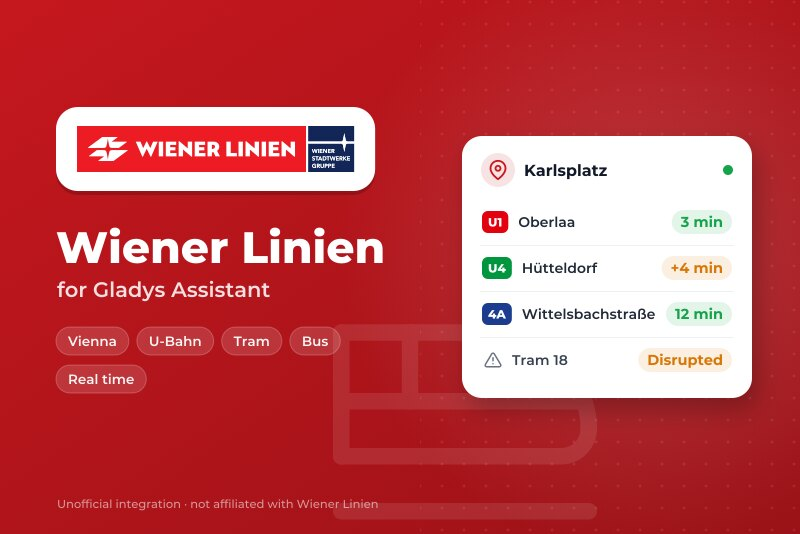
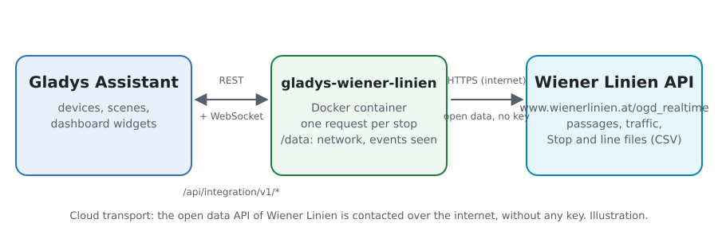
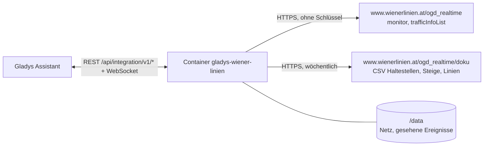
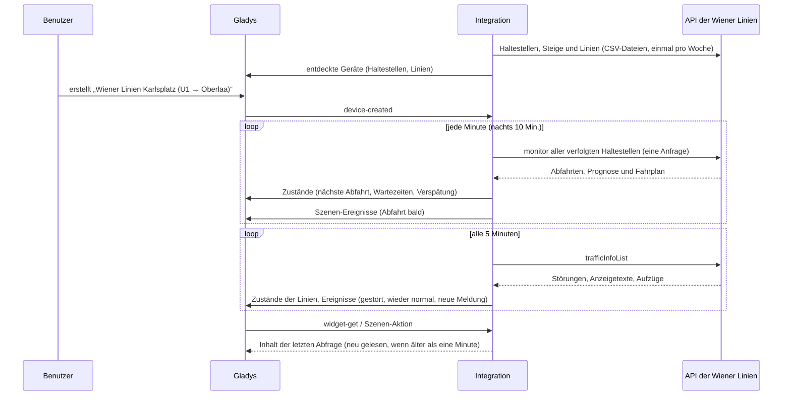
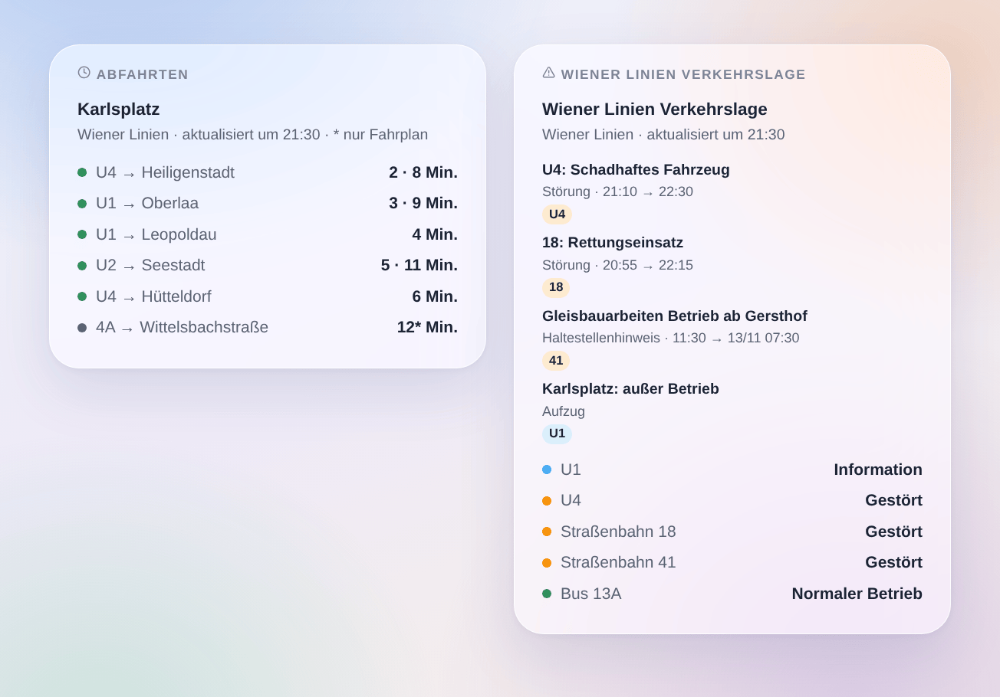

# Gladys Wiener Linien

[English](README.md) · [Français](README.fr.md) · **Deutsch** · [Español](README.es.md)

[](LICENSE)
[](https://github.com/William-De71/gladys-wiener-linien/releases)
[](https://github.com/William-De71/gladys-wiener-linien/actions/workflows/release.yml)
[](https://gladysassistant.com)



Externe Integration für [Gladys Assistant](https://gladysassistant.com) für die **Wiener Linien**, U-Bahn, Straßenbahn und Bus in Wien: die nächsten Abfahrten in Echtzeit an deinen Haltestellen samt Verspätung und die Verkehrslage deiner Linien, mit Szenen und Dashboard-Widgets. Sie liest die offizielle Echtzeit-Schnittstelle der Wiener Linien, Open Data der Stadt Wien: kein Konto, kein Schlüssel.

Benutzerdokumentation: [English](docs/en.md) · [Français](docs/fr.md) · [Deutsch](docs/de.md) · [Español](docs/es.md).

> Community-Integration, weder mit den Wiener Linien, den Wiener Stadtwerken oder der Stadt Wien verbunden noch von ihnen unterstützt.

> Datenquelle: Stadt Wien – [data.wien.gv.at](https://data.wien.gv.at) (CC BY 4.0).

## Funktionen

- **Ein Gerät pro verfolgter Haltestelle** (drei im Formular, bis zu 7 weitere über **Haltestelle hinzufügen**), eingegeben per Name oder Nummer („60200657“ für die ganze Haltestelle, eine StopID für einen Steig) und gefiltert nach **Linie** („U1“, „13A“, „D“ oder „U-Bahn“, „Tram“, „Bus“) und **Richtung**: nächste Abfahrt, Wartezeit der nächsten beiden Abfahrten, **Verspätung** der nächsten, Zahl der Verkehrsmeldungen zur Haltestelle.
- **Ein Gerät pro verfolgter Linie**: ihr Zustand (normal, Information, gestört, stark gestört) und die Zahl ihrer Verkehrsmeldungen.
- **Echtzeit und Verspätung**: die Prognose, wenn das Fahrzeug live verfolgt wird, samt Verspätung gegenüber dem Fahrplan; sonst die Fahrplanzeit (als solche gekennzeichnet).
- **Aufzüge außer Betrieb**, auf Wunsch zu den Verkehrsmeldungen gezählt (barrierefreier Zugang).
- **4 Szenen-Auslöser**, **2 Szenen-Aktionen** und **2 Dashboard-Widgets** (siehe unten).
- **Schonend zur Schnittstelle**: eine Anfrage für alle Haltestellen, Antworten 15 Sekunden behalten, 5 Minuten Pause bei erreichtem Abfragelimit, nachts weniger Abfragen.
- **Haltestellensuche ohne die Echtzeit-Schnittstelle**: Namen und Nummern stammen aus den Open-Data-Dateien der Wiener Linien, wöchentlich gelesen und in `/data` behalten.
- Konfigurationsschaltflächen: Verbindung testen, Haltestelle suchen, Haltestellen hinzufügen / entfernen / auflisten, Diagnose.
- Überall vier Sprachen: Englisch, Französisch, Deutsch, Spanisch.

## Funktionsweise





Beim Start liest die Integration Haltestellen, Steige und Linien aus den Open-Data-Dateien der Wiener Linien: Eine **DIVA-Nummer** („60200657“) ist eine ganze Haltestelle, eine **StopID** („4120“) einer ihrer Steige. Sie löst deine Eingaben auf und liest dann **alle verfolgten Haltestellen in einer Anfrage** (`monitor?diva=60200657&diva=60201510`) nach eigenem Timer, dazu die Verkehrslage des Netzes (`trafficInfoList`) alle 5 Minuten. Jede Abfrage wird mit der vorigen verglichen, um die Szenen-Auslöser zu feuern.



### Transport

Nur Cloud (`"transports": ["cloud"]`): Der Katalog zeigt das Cloud-Abzeichen. Die Integration kontaktiert ausschließlich `www.wienerlinien.at`, mit den Nummern deiner Haltestellen. Eine lokale Alternative gibt es nicht, also auch keine Schaltfläche „Lokale Verbindung bevorzugen“.

## Geräte und Funktionen

| Gerät                                     | Funktion                           | Kategorie / Typ              | Werte                             |
| ----------------------------------------- | ---------------------------------- | ---------------------------- | --------------------------------- |
| Wiener Linien \<Haltestelle\>             | Nächste Abfahrt                    | `text` / `text`              | „U1 → Oberlaa · 3 Min. (+4 Min.)“ |
| Wiener Linien \<Haltestelle\>             | Wartezeit, Wartezeit der folgenden | `duration` / `integer`       | 0 … 180 Min.                      |
| Wiener Linien \<Haltestelle\>             | Verspätung der nächsten Abfahrt    | `duration` / `integer`       | 0 … 180 Min.                      |
| Wiener Linien \<Haltestelle\>             | Verkehrsmeldungen der Haltestelle  | `counter-sensor` / `integer` | 0 … 20                            |
| Wiener Linien U1, Straßenbahn 18, Bus 13A | Verkehr                            | `text` / `text`              | „Gestört: 18: Rettungseinsatz“    |
| Wiener Linien U1, Straßenbahn 18, Bus 13A | Verkehrsmeldungen                  | `counter-sensor` / `integer` | 0 … 20                            |

Nachts, ohne Abfahrt, behalten die Wartezeiten ihren letzten Wert (eine 0 würde einen Zug jetzt ankündigen). Die Verspätung wird nur für live verfolgte Abfahrten veröffentlicht. Die Schnittstelle nennt keine ausgefallenen Fahrten: Die Integration erfindet keine.

## Szenen-Auslöser, Aktionen und Widgets



**Szenen-Auslöser** (einmal pro Übergang; die erste Abfrage ist eine Referenz und löst nichts aus):

- **Abfahrt bald**: Ein Fahrzeug an einer verfolgten Haltestelle fährt in 2, 3, 5, 10, 15 oder 20 Minuten ab. Filter: Haltestelle, Minuten. Variablen: Linie, Ziel, Uhrzeit, Echtzeit, Verspätung, Zusammenfassung.
- **Linie gestört**: Eine verfolgte Linie wird gestört oder stark gestört. Filter: Linie.
- **Wieder normal**: Eine verfolgte Linie, die gestört war, fährt wieder normal. Filter: Linie.
- **Neue Verkehrsmeldung**: eine neue Meldung zu einer verfolgten Linie oder Haltestelle – Störung der Leitstelle, Sondertext einer Haltestellenanzeige, Aufzug, falls verfolgt; eine Störung mit geändertem Text löst erneut aus. Filter: Linie oder Haltestelle, Art.

**Szenen-Aktionen**: **nächste Abfahrten** einer Haltestelle (Linie, Ziel, Wartezeit, Uhrzeit, Echtzeit oder nicht, Verspätung, die folgende, ein Satz) und **Verkehrslage einer Linie** (Zustand, gestört oder nicht, Zahl der Meldungen, letzte Meldung, ein Satz).

**Widgets**: **Abfahrten** (eine verfolgte Haltestelle, mehrere in einer Liste oder eine beliebige, in den Einstellungen eingegebene Haltestelle) und **Wiener Linien Verkehrslage** (die verfolgten Linien, die eingegebenen Linien oder die U-Bahn-Linien).

Beispiele:

- Wenn **die U1 Richtung Oberlaa in 5 Minuten am Karlsplatz abfährt** → die Flurlampe grün leuchten lassen.
- Wenn **die U4 gestört wird** → `{{triggerEvent.data.summary}}` aufs Handy schicken.
- Jeden Werktag um 7:30 Uhr → **die nächsten Abfahrten** deiner Haltestelle lesen und die `summary` vom Küchenlautsprecher ansagen lassen.

## Voraussetzungen

- Gladys Assistant **5.3.0** oder neuer (Widgets und Szenen-Auslöser externer Integrationen, Katalog-Schlagwörter und -Länder von Gladys 5.3). Ältere Instanzen können die Integration nicht installieren.
- Internetzugang vom Gladys-Server. Kein Konto, kein Schlüssel.

## Installation

- **Aus dem Store** von Gladys (Integrationen → Externe Integrationen), mit einem Klick, sobald die Integration indexiert ist.
- **Über die Repository-URL**: `https://github.com/William-De71/gladys-wiener-linien`.
- **Entwicklermodus**: Baue das Image lokal (`docker build -t gladys-wiener-linien .`) und installiere es aus Gladys.

## Konfiguration

| Feld                     | Beschreibung                                                                             |
| ------------------------ | ---------------------------------------------------------------------------------------- |
| Haltestelle (1 bis 3)    | Ein Name („Karlsplatz“, „Stephansplatz“) oder eine Nummer („60200657“ oder eine StopID). |
| Linie                    | „U1“, „13A“, „D“ oder „U-Bahn“, „Tram“, „Bus“. Leer: alle Linien der Haltestelle.        |
| Richtung                 | Wörter des Ziels: „Oberlaa“, „Oberlaa \| Reumannplatz“. Leer: beide.                     |
| Verfolgte Linien         | „U1, U4, 13A, D“ (höchstens 10): ein Gerät pro Linie mit ihrer Verkehrslage.             |
| Aufzüge verfolgen        | Zählt Aufzüge außer Betrieb zu den Verkehrsmeldungen. Standardmäßig aus.                 |
| Abfrage der Haltestellen | 30 s, 1 Min. (Standard), 2 Min. oder 5 Min.; nachts 10 Min.                              |
| Sprache der Texte        | Gerätenamen, Zusammenfassungen und Ausgaben der Szenen. Die Meldungen bleiben deutsch.   |

Schaltflächen: **Verbindung testen**, **Haltestelle suchen** (aus den Open-Data-Dateien, ohne die Echtzeit-Schnittstelle), **Haltestelle hinzufügen**, **Haltestelle entfernen**, **Haltestellen auflisten** (die Haltestellen über die drei des Formulars hinaus, in der Gladys-Konfiguration gespeichert) und **Diagnose** (schreibt Haltestellen, Linien, letzte Abfahrten, Verkehrsmeldungen, Fehler und Anfragen in den Tab Protokolle).

## Verwendung

1. Trage eine bis drei Haltestellen ein – mehr über **Haltestelle hinzufügen** – (auf Wunsch mit Linie und Richtung) sowie die zu verfolgenden Linien und speichere. Mehr ist nicht zu konfigurieren.
2. Erstelle im Tab **Entdecken** die Geräte „Wiener Linien …“.
3. Füge die Widgets **Abfahrten** und **Wiener Linien Verkehrslage** einem Dashboard hinzu und baue Szenen mit den Auslösern oben.

## Entwicklung

```bash
npm install
npm test                       # node --test, berührt nie das Netzwerk
npm run lint && npm run format:check
npx github:GladysAssistant/integration-store . --skip-image-check
scripts/build-cover.sh         # cover.jpg aus docs/assets/cover.svg
docs/illustrations/render.sh   # docs/assets/widgets.<lang>.png
node .github/scripts/release.mjs next
```

Lokal liest das SDK `GLADYS_HOST_API_URL`, `GLADYS_INTEGRATION_TOKEN` und `GLADYS_INTEGRATION_SELECTOR`; `WL_API_URL` und `WL_DATA_URL` lenken die Integration auf andere Adressen (ein Mock); `DEBUG=gladys-integration-sdk` zeigt die SDK-Logs und prüft jeden Widget-Inhalt. Die Tests verwenden Antworten, die mit den an der echten Schnittstelle aufgezeichneten Feldern gebaut wurden, und Auszüge der echten Haltestellen- und Liniendateien (`test/fixtures/`, CC BY 4.0). Die Regeln des Projekts stehen in [CLAUDE.md](CLAUDE.md).

## Release-Prozess


Jeder Merge auf `main` startet die CI und berechnet dann die Version aus den [Conventional Commits](https://www.conventionalcommits.org/) seit dem letzten Tag: `feat` → Minor, `fix` / `perf` → Patch, `!` oder `BREAKING CHANGE` → Major (Minor unter 1.0.0); `docs`, `chore`, `ci`, `test`, `style`, `refactor`, `build` allein veröffentlichen nichts. Der Changelog-Abschnitt wird erzeugt, der Tag gepusht, das Multi-Architektur-Image gebaut, dann erhält `main` den Release-Commit, die GitHub Release wird erstellt, und ein letzter Job prüft das öffentliche Image, den Store-Validator und das Topic.

- Der Titel des Pull Requests wird zum Squash-Commit und dann zur Changelog-Zeile: Schreibe ihn auf Englisch, für die Benutzer (`pr-title.yml` prüft ihn). Bearbeite `CHANGELOG.md` nie von Hand.
- 1.0.0 ist eine Entscheidung: Actions → Release → Run workflow mit `release-as: 1.0.0`. `dry-run` zeigt Version und Notizen, ohne zu veröffentlichen.
- **Geschützter Branch**: Die Release pusht ihren Commit mit `GITHUB_TOKEN` auf `main`. Bei einem Ruleset auf `main`, das strenger ist als „kein Löschen, kein Force-Push“, füge GitHub Actions der Bypass-Liste hinzu (oder pushe über eine GitHub App), sonst schlägt der Veröffentlichungsjob mit Anweisungen fehl.
- Mache nach der ersten Release das `ghcr.io`-Paket öffentlich (Package settings → Change visibility), sonst kann Gladys es nicht laden.

## Fehlerbehebung

Siehe [docs/de.md](docs/de.md#fehlerbehebung). Melde Probleme mit den Versionen von Gladys und der Integration, der betroffenen Haltestelle oder Linie und den Zeilen der Schaltfläche **Diagnose**.

## Mitwirken

Issues und Pull Requests sind willkommen. Führe vor einem Pull Request `npm run format:check && npm run lint && npm test` aus und lasse alle externen IDs und gespeicherten Schlüssel unverändert (siehe [CLAUDE.md](CLAUDE.md)).

## Sicherheit

Siehe [SECURITY.md](SECURITY.md): Melde Schwachstellen vertraulich. Die Integration hält kein Geheimnis: Die Schnittstelle ist offen und erhält nur die Nummern deiner Haltestellen. Der Container läuft schreibgeschützt als Nicht-Root-Benutzer.

## Kommende Screenshots

Die Bilder oben sind Illustrationen, keine Screenshots. Echte Screenshots kommen nach `docs/assets/screenshots/` (PNG, 1280 × 800): `configuration.png`, `discovery.png`, `device.png`, `scene.png`.

## Lizenz

[Apache License 2.0](LICENSE) – siehe auch [NOTICE](NOTICE). Abfahrten, Verkehrsmeldungen und Haltestellen sind Open Data der Stadt Wien unter [CC BY 4.0](https://creativecommons.org/licenses/by/4.0/) – Datenquelle: Stadt Wien – data.wien.gv.at: Die Widgets zeigen die Quelle und die Zeit jeder Abfrage. Danke an die Dokumentation und das SDK von Gladys und an die Wiener Linien für die offene Echtzeit-Schnittstelle.
