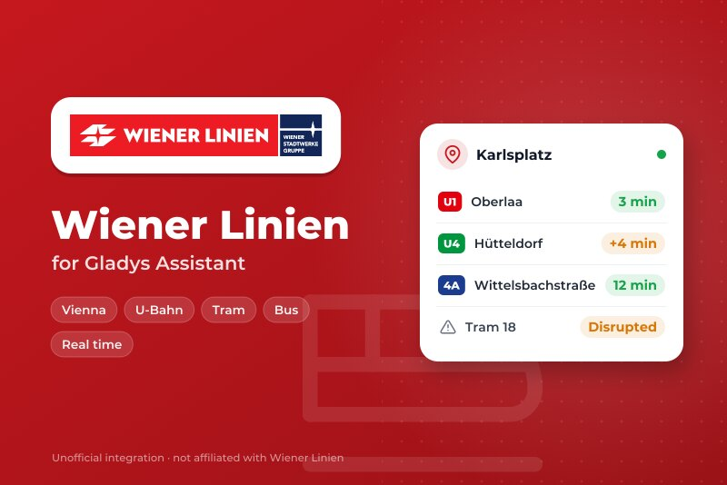
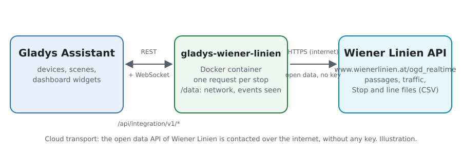
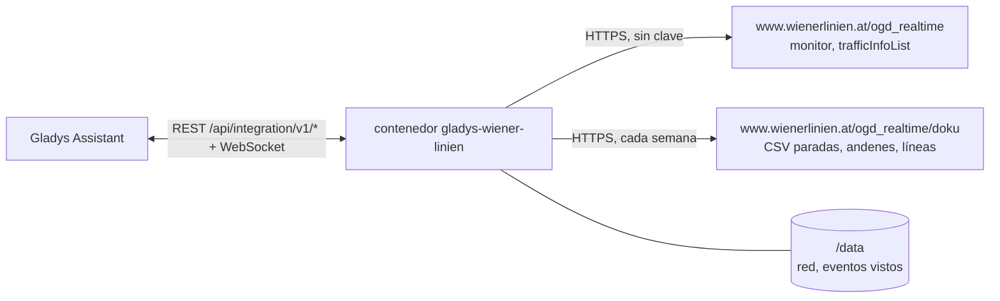
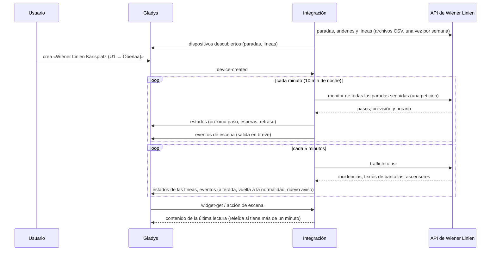
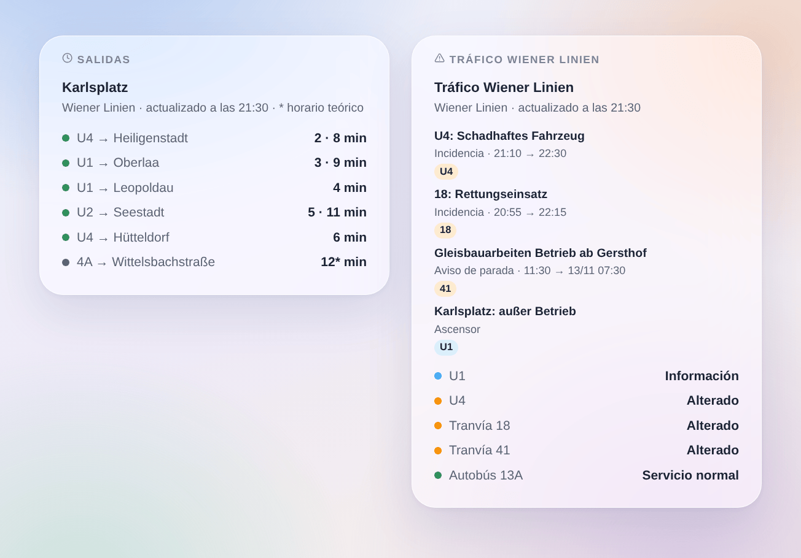
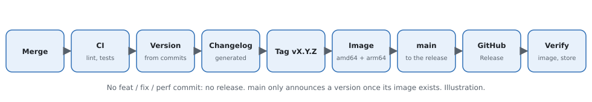

# Gladys Wiener Linien

[English](README.md) · [Français](README.fr.md) · [Deutsch](README.de.md) · **Español**

[](LICENSE)
[](https://github.com/William-De71/gladys-wiener-linien/releases)
[](https://github.com/William-De71/gladys-wiener-linien/actions/workflows/release.yml)
[](https://gladysassistant.com)



Integración externa de [Gladys Assistant](https://gladysassistant.com) para **Wiener Linien**, el metro (U-Bahn), los tranvías y los autobuses de Viena: los próximos pasos en tiempo real en tus paradas, con su retraso, y el tráfico de tus líneas, con escenas y widgets de panel. Lee la API oficial en tiempo real de Wiener Linien, datos abiertos de la Ciudad de Viena: sin cuenta ni clave.

Documentación de usuario: [English](docs/en.md) · [Français](docs/fr.md) · [Deutsch](docs/de.md) · [Español](docs/es.md).

> Integración comunitaria, no afiliada ni respaldada por Wiener Linien, Wiener Stadtwerke o la Ciudad de Viena.

> Fuente de los datos: Ciudad de Viena – [data.wien.gv.at](https://data.wien.gv.at) (CC BY 4.0).

## Funciones

- **Un dispositivo por parada seguida** (tres en el formulario, hasta 7 más con el botón **Añadir una parada**), escrita por su nombre o su número («60200657» para toda la parada, un StopID para un solo andén) y filtrada por **línea** («U1», «13A», «D», o «U-Bahn», «tram», «bus») y **dirección**: próximo paso, espera de los dos próximos pasos, **retraso** del próximo, número de avisos de tráfico sobre la parada.
- **Un dispositivo por línea seguida**: su estado de tráfico (normal, información, alterado, muy alterado) y su número de avisos de tráfico.
- **Tiempo real y retraso**: la previsión cuando el vehículo se sigue en directo, con su retraso sobre el horario; si no, el horario teórico (indicado como tal).
- **Ascensores fuera de servicio**, contados entre los avisos de tráfico si lo pides (acceso sin escalones).
- **4 disparadores de escena**, **2 acciones de escena** y **2 widgets de panel** (más abajo).
- **Respetuosa con la API**: una sola petición para todas las paradas, respuestas conservadas 15 segundos, pausa de 5 minutos cuando se alcanza el límite de peticiones, menos lecturas de noche.
- **Búsqueda de paradas sin consultar la API en tiempo real**: los nombres y números vienen de los archivos open data de Wiener Linien, leídos cada semana y guardados en `/data`.
- Botones de configuración: probar la conexión, buscar una parada, añadir / quitar / listar paradas, diagnóstico.
- Cuatro idiomas en todas partes: inglés, francés, alemán, español.

## Funcionamiento





Al arrancar, la integración lee las paradas, andenes y líneas de los archivos open data de Wiener Linien: un **número DIVA** («60200657») es una parada entera, un **StopID** («4120») uno de sus andenes. Resuelve lo que has escrito y luego lee **todas las paradas seguidas en una sola petición** (`monitor?diva=60200657&diva=60201510`) con su propio temporizador, y el tráfico de la red (`trafficInfoList`) cada 5 minutos. Cada lectura se compara con la anterior para lanzar los disparadores de escena.



### Transporte

Solo cloud (`"transports": ["cloud"]`): el catálogo muestra la insignia cloud. La integración solo contacta con `www.wienerlinien.at`, con los números de tus paradas. No hay alternativa local, así que no hay botón «Preferir la conexión local».

## Dispositivos y funciones

| Dispositivo                               | Función                        | Categoría / tipo             | Valores                         |
| ----------------------------------------- | ------------------------------ | ---------------------------- | ------------------------------- |
| Wiener Linien \<parada\>                  | Próximo paso                   | `text` / `text`              | «U1 → Oberlaa · 3 min (+4 min)» |
| Wiener Linien \<parada\>                  | Espera, espera del siguiente   | `duration` / `integer`       | 0 … 180 min                     |
| Wiener Linien \<parada\>                  | Retraso del próximo paso       | `duration` / `integer`       | 0 … 180 min                     |
| Wiener Linien \<parada\>                  | Avisos de tráfico de la parada | `counter-sensor` / `integer` | 0 … 20                          |
| Wiener Linien U1, tranvía 18, autobús 13A | Tráfico                        | `text` / `text`              | «Alterado: 18: Rettungseinsatz» |
| Wiener Linien U1, tranvía 18, autobús 13A | Avisos de tráfico              | `counter-sensor` / `integer` | 0 … 20                          |

De noche, sin ningún paso, las esperas conservan su último valor (un 0 anunciaría un tren ahora). El retraso solo se publica para un paso seguido en directo. La API no lista ningún servicio suprimido: la integración no inventa ninguno.

## Disparadores, acciones de escena y widgets



**Disparadores de escena** (una vez por transición; la primera lectura es una referencia y no dispara nada):

- **Salida en breve**: un vehículo de una parada seguida sale dentro de 2, 3, 5, 10, 15 o 20 minutos. Filtros: parada, minutos. Variables: línea, destino, hora, tiempo real, retraso, resumen.
- **Línea alterada**: una línea seguida pasa a estar alterada o muy alterada. Filtro: línea.
- **Fin de la incidencia**: una línea seguida que estaba alterada vuelve a la normalidad. Filtro: línea.
- **Nuevo aviso de tráfico**: un nuevo aviso sobre una línea o parada seguida — incidencia del centro de control, texto especial de una pantalla de parada, ascensor si se siguen; una incidencia cuyo texto cambia se dispara de nuevo. Filtros: línea o parada, tipo.

**Acciones de escena**: **próximas salidas** de una parada (línea, destino, espera, hora, tiempo real o no, retraso, el siguiente, una frase) y **tráfico de una línea** (estado, alterada o no, número de avisos, último aviso, una frase).

**Widgets**: **Salidas** (una parada seguida, varias en una sola lista, o cualquier parada escrita en los ajustes) y **Tráfico Wiener Linien** (las líneas seguidas, las líneas escritas o las líneas de metro).

Ejemplos:

- Cuando **la U1 hacia Oberlaa sale de Karlsplatz dentro de 5 minutos** → encender en verde la lámpara de la entrada.
- Cuando **la U4 pasa a estar alterada** → enviar `{{triggerEvent.data.summary}}` a tu teléfono.
- Cada día laborable a las 7:30 → **leer las próximas salidas** de tu parada y hacer que el altavoz de la cocina diga el `summary`.

## Requisitos

- Gladys Assistant **5.3.0** o posterior (widgets y disparadores de escena de las integraciones externas, palabras clave y países del catálogo de Gladys 5.3). Las instancias más antiguas no pueden instalar la integración.
- Acceso a Internet desde el servidor de Gladys. Sin cuenta ni clave.

## Instalación

- **Desde la tienda** de Gladys (Integraciones → Integraciones externas), en un clic, una vez indexada.
- **Desde la URL del repositorio**: `https://github.com/William-De71/gladys-wiener-linien`.
- **Modo desarrollador**: construye la imagen en local (`docker build -t gladys-wiener-linien .`) e instálala desde Gladys.

## Configuración

| Campo                  | Descripción                                                                               |
| ---------------------- | ----------------------------------------------------------------------------------------- |
| Parada (1 a 3)         | Un nombre («Karlsplatz», «Stephansplatz») o un número («60200657», o un StopID).          |
| Línea                  | «U1», «13A», «D», o «U-Bahn», «tram», «bus». Vacío: todas las líneas de la parada.        |
| Dirección              | Palabras del destino: «Oberlaa», «Oberlaa \| Reumannplatz». Vacío: ambos sentidos.        |
| Líneas seguidas        | «U1, U4, 13A, D» (10 como máximo): un dispositivo por línea con su tráfico.               |
| Seguir los ascensores  | Cuenta los ascensores fuera de servicio entre los avisos. Desactivado por defecto.        |
| Lectura de las paradas | 30 s, 1 min (por defecto), 2 min o 5 min; 10 min de noche.                                |
| Idioma de los textos   | Nombres de dispositivos, resúmenes y salidas de las escenas. Los avisos siguen en alemán. |

Botones: **Probar la conexión**, **Buscar una parada** (en los archivos open data, sin consultar la API en tiempo real), **Añadir una parada**, **Quitar una parada**, **Listar las paradas** (las paradas más allá de las tres del formulario, guardadas en la configuración de Gladys) y **Diagnóstico** (escribe las paradas, líneas, últimos pasos, avisos de tráfico, errores y peticiones en la pestaña Registros).

## Uso

1. Escribe de una a tres paradas — más con **Añadir una parada** — (con su línea y dirección si quieres) y las líneas que seguir, y guarda. No hay nada más que configurar.
2. En la pestaña **Descubrir**, crea los dispositivos «Wiener Linien …».
3. Añade los widgets **Salidas** y **Tráfico Wiener Linien** a un panel, y crea escenas con los disparadores de arriba.

## Desarrollo

```bash
npm install
npm test                       # node --test, nunca toca la red
npm run lint && npm run format:check
npx github:GladysAssistant/integration-store . --skip-image-check
scripts/build-cover.sh         # cover.jpg desde docs/assets/cover.svg
docs/illustrations/render.sh   # docs/assets/widgets.<lang>.png
node .github/scripts/release.mjs next
```

En local, el SDK lee `GLADYS_HOST_API_URL`, `GLADYS_INTEGRATION_TOKEN` y `GLADYS_INTEGRATION_SELECTOR`; `WL_API_URL` y `WL_DATA_URL` apuntan la integración a otras raíces (un simulador); `DEBUG=gladys-integration-sdk` muestra los registros del SDK y comprueba cada contenido de widget. Los tests usan respuestas construidas con los campos registrados en la API real y extractos de los archivos reales de paradas y líneas (`test/fixtures/`, CC BY 4.0). Las reglas del proyecto están en [CLAUDE.md](CLAUDE.md).

## Proceso de release



Cada fusión en `main` ejecuta la CI y luego calcula la versión a partir de los [Conventional Commits](https://www.conventionalcommits.org/) desde el último tag: `feat` → menor, `fix` / `perf` → parche, `!` o `BREAKING CHANGE` → mayor (menor por debajo de 1.0.0); `docs`, `chore`, `ci`, `test`, `style`, `refactor`, `build` solos no publican nada. Se genera la sección del changelog, se empuja el tag, se construye la imagen multiarquitectura, luego `main` recibe el commit de release, se crea la GitHub Release y un último job comprueba la imagen pública, el validador de la tienda y el topic.

- El título de la pull request se convierte en el commit squash y luego en la línea del changelog: escríbelo en inglés, para el usuario (`pr-title.yml` lo comprueba). Nunca edites `CHANGELOG.md` a mano.
- La 1.0.0 es una decisión: Actions → Release → Run workflow con `release-as: 1.0.0`. `dry-run` muestra la versión y las notas sin publicar.
- **Rama protegida**: la release empuja su commit a `main` con `GITHUB_TOKEN`. Con un ruleset en `main` más estricto que «sin borrado ni force-push», añade GitHub Actions a su lista de excepciones (o empuja mediante una GitHub App); si no, el job de publicación falla con instrucciones.
- Tras la primera release, haz público el paquete `ghcr.io` (Package settings → Change visibility), o Gladys no podrá descargarlo.

## Solución de problemas

Consulta [docs/es.md](docs/es.md#solución-de-problemas). Informa de los problemas con las versiones de Gladys y de la integración, la parada o línea afectada y las líneas del botón **Diagnóstico**.

## Contribuir

Las issues y pull requests son bienvenidas. Ejecuta `npm run format:check && npm run lint && npm test` antes de abrir una pull request, y mantén sin cambios todos los identificadores externos y las claves almacenadas (consulta [CLAUDE.md](CLAUDE.md)).

## Seguridad

Consulta [SECURITY.md](SECURITY.md): informa de las vulnerabilidades en privado. La integración no guarda ningún secreto: la API es abierta y solo recibe los números de tus paradas. El contenedor se ejecuta en solo lectura, con un usuario sin privilegios.

## Capturas pendientes

Las imágenes de arriba son ilustraciones, no capturas de pantalla. Las capturas reales irán en `docs/assets/screenshots/` (PNG, 1280 × 800): `configuration.png`, `discovery.png`, `device.png`, `scene.png`.

## Licencia

[Apache License 2.0](LICENSE) — consulta también [NOTICE](NOTICE). Los pasos, los avisos de tráfico y las paradas son datos abiertos de la Ciudad de Viena bajo [CC BY 4.0](https://creativecommons.org/licenses/by/4.0/) — fuente de los datos: Ciudad de Viena – data.wien.gv.at: los widgets muestran la fuente y la hora de cada lectura. Gracias a la documentación y al SDK de Gladys, y a Wiener Linien por abrir su API en tiempo real.
