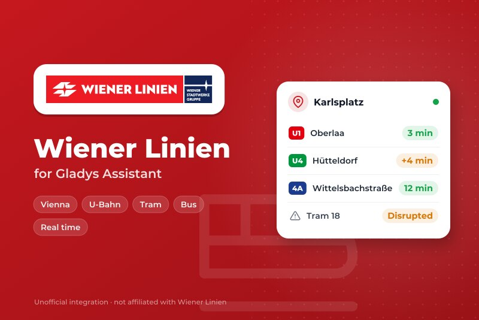
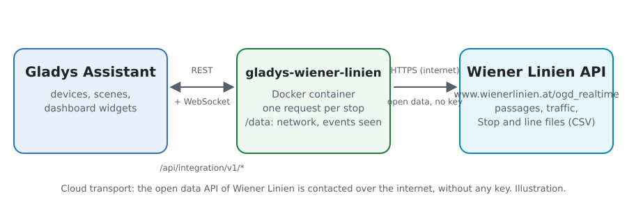
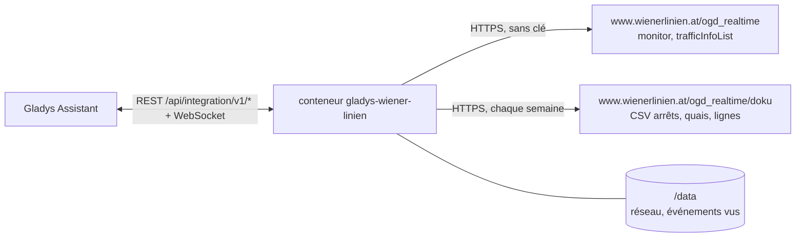
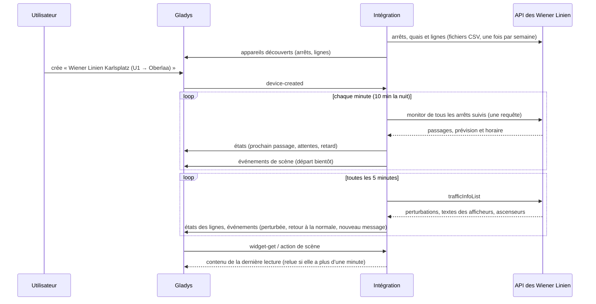
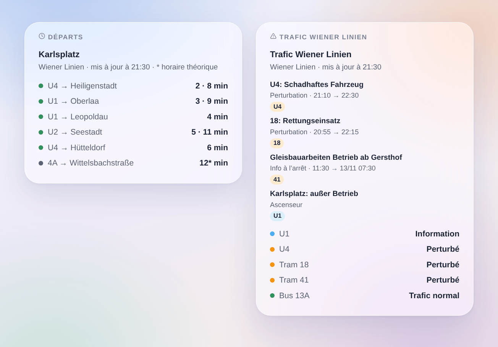

# Gladys Wiener Linien

[English](README.md) · **Français** · [Deutsch](README.de.md) · [Español](README.es.md)

[](LICENSE)
[](https://github.com/William-De71/gladys-wiener-linien/releases)
[](https://github.com/William-De71/gladys-wiener-linien/actions/workflows/release.yml)
[](https://gladysassistant.com)



Intégration externe [Gladys Assistant](https://gladysassistant.com) pour les **Wiener Linien**, le métro (U-Bahn), les trams et les bus de Vienne : les prochains passages en temps réel à vos arrêts, avec leur retard, et le trafic de vos lignes, avec scènes et widgets de tableau de bord. Elle lit l’API temps réel officielle des Wiener Linien, données ouvertes de la Ville de Vienne : ni compte, ni clé.

Documentation utilisateur : [English](docs/en.md) · [Français](docs/fr.md) · [Deutsch](docs/de.md) · [Español](docs/es.md).

> Intégration communautaire, ni affiliée à ni approuvée par les Wiener Linien, les Wiener Stadtwerke ou la Ville de Vienne.

> Source des données : Ville de Vienne – [data.wien.gv.at](https://data.wien.gv.at) (CC BY 4.0).

## Fonctionnalités

- **Un appareil par arrêt suivi** (trois dans le formulaire, jusqu’à 7 de plus avec le bouton **Ajouter un arrêt**), saisi par son nom ou son numéro (« 60200657 » pour tout l’arrêt, un StopID pour un seul quai) et filtré par **ligne** (« U1 », « 13A », « D », ou « U-Bahn », « tram », « bus ») et par **direction** : prochain passage, attente des deux prochains passages, **retard** du prochain, nombre de messages de trafic sur l’arrêt.
- **Un appareil par ligne suivie** : son état de trafic (normal, information, perturbé, très perturbé) et son nombre de messages de trafic.
- **Temps réel et retard** : la prévision quand le véhicule est suivi en direct, avec son retard sur l’horaire ; l’horaire théorique sinon (signalé comme tel).
- **Ascenseurs hors service**, comptés parmi les messages de trafic si vous le demandez (accès sans marche).
- **4 déclencheurs de scène**, **2 actions de scène** et **2 widgets de tableau de bord** (ci-dessous).
- **Respectueuse de l’API** : une seule requête pour tous les arrêts, réponses gardées 15 secondes, pause de 5 minutes quand la limite de requêtes est atteinte, moins de lectures la nuit.
- **Recherche d’arrêt sans solliciter l’API temps réel** : les noms et numéros viennent des fichiers open data des Wiener Linien, lus chaque semaine et gardés dans `/data`.
- Boutons de configuration : tester la connexion, chercher un arrêt, ajouter / retirer / lister les arrêts, diagnostic.
- Quatre langues partout : anglais, français, allemand, espagnol.

## Fonctionnement





Au démarrage, l’intégration lit les arrêts, quais et lignes des fichiers open data des Wiener Linien : un **numéro DIVA** (« 60200657 ») est un arrêt entier, un **StopID** (« 4120 ») l’un de ses quais. Elle résout ce que vous avez saisi, puis lit **tous les arrêts suivis en une seule requête** (`monitor?diva=60200657&diva=60201510`) sur son propre minuteur, et le trafic du réseau (`trafficInfoList`) toutes les 5 minutes. Chaque lecture est comparée à la précédente pour lancer les déclencheurs de scène.



### Transport

Cloud uniquement (`"transports": ["cloud"]`) : le catalogue affiche le badge cloud. L’intégration contacte uniquement `www.wienerlinien.at`, avec les numéros de vos arrêts. Il n’existe pas d’alternative locale, donc pas de bouton « Préférer la connexion locale ».

## Appareils et fonctionnalités

| Appareil                           | Fonctionnalité              | Catégorie / type             | Valeurs                            |
| ---------------------------------- | --------------------------- | ---------------------------- | ---------------------------------- |
| Wiener Linien \<arrêt\>            | Prochain passage            | `text` / `text`              | « U1 → Oberlaa · 3 min (+4 min) »  |
| Wiener Linien \<arrêt\>            | Attente, attente du suivant | `duration` / `integer`       | 0 … 180 min                        |
| Wiener Linien \<arrêt\>            | Retard du prochain passage  | `duration` / `integer`       | 0 … 180 min                        |
| Wiener Linien \<arrêt\>            | Infos trafic de l’arrêt     | `counter-sensor` / `integer` | 0 … 20                             |
| Wiener Linien U1, tram 18, bus 13A | Trafic                      | `text` / `text`              | « Perturbé : 18: Rettungseinsatz » |
| Wiener Linien U1, tram 18, bus 13A | Infos trafic                | `counter-sensor` / `integer` | 0 … 20                             |

La nuit, sans aucun passage, les attentes gardent leur dernière valeur (un 0 annoncerait une rame tout de suite). Le retard n’est publié que pour un passage suivi en direct. L’API ne liste aucune course supprimée : l’intégration n’en invente pas.

## Déclencheurs, actions de scène et widgets



**Déclencheurs de scène** (une fois par transition ; la première lecture sert de référence et ne déclenche rien) :

- **Départ bientôt** : un véhicule d’un arrêt suivi part dans 2, 3, 5, 10, 15 ou 20 minutes. Filtres : arrêt, minutes. Variables : ligne, destination, heure, temps réel, retard, résumé.
- **Ligne perturbée** : une ligne suivie devient perturbée ou très perturbée. Filtre : ligne.
- **Fin de perturbation** : une ligne suivie qui était perturbée revient à la normale. Filtre : ligne.
- **Nouveau message trafic** : un nouveau message sur une ligne ou un arrêt suivi — perturbation du poste de commande, texte spécial d’un afficheur d’arrêt, ascenseur s’ils sont suivis ; une perturbation dont le texte change se redéclenche. Filtres : ligne ou arrêt, type.

**Actions de scène** : **prochains départs** d’un arrêt (ligne, destination, attente, heure, temps réel ou non, retard, le suivant, une phrase) et **trafic d’une ligne** (état, perturbée ou non, nombre de messages, dernier message, une phrase).

**Widgets** : **Départs** (un arrêt suivi, plusieurs dans une seule liste, ou n’importe quel arrêt saisi dans les réglages) et **Trafic Wiener Linien** (les lignes suivies, les lignes saisies, ou les lignes de métro).

Exemples :

- Quand **la U1 vers Oberlaa part de Karlsplatz dans 5 minutes** → allumer la lampe de l’entrée en vert.
- Quand **la U4 devient perturbée** → envoyer `{{triggerEvent.data.summary}}` sur votre téléphone.
- Chaque jour de semaine à 7 h 30 → **lire les prochains départs** de votre arrêt et faire dire le `summary` par l’enceinte de la cuisine.

## Prérequis

- Gladys Assistant **5.3.0** ou plus récent (widgets et déclencheurs de scène des intégrations externes, mots-clés et pays du catalogue de Gladys 5.3). Les instances plus anciennes ne peuvent pas installer l’intégration.
- Un accès à Internet depuis le serveur Gladys. Ni compte, ni clé.

## Installation

- **Depuis le store** de Gladys (Intégrations → Intégrations externes), en un clic, une fois l’intégration indexée.
- **Depuis l’URL du dépôt** : `https://github.com/William-De71/gladys-wiener-linien`.
- **Mode développeur** : construisez l’image en local (`docker build -t gladys-wiener-linien .`) et installez-la depuis Gladys.

## Configuration

| Champ                 | Description                                                                            |
| --------------------- | -------------------------------------------------------------------------------------- |
| Arrêt (1 à 3)         | Un nom (« Karlsplatz », « Stephansplatz ») ou un numéro (« 60200657 », ou un StopID).  |
| Ligne                 | « U1 », « 13A », « D », ou « U-Bahn », « tram », « bus ». Vide : toutes les lignes.    |
| Direction             | Mots de la destination : « Oberlaa », « Oberlaa \| Reumannplatz ». Vide : les deux.    |
| Lignes suivies        | « U1, U4, 13A, D » (10 au plus) : un appareil par ligne avec son trafic.               |
| Suivre les ascenseurs | Compte les ascenseurs hors service parmi les messages de trafic. Désactivé par défaut. |
| Lecture des arrêts    | 30 s, 1 min (par défaut), 2 min ou 5 min ; 10 min la nuit.                             |
| Langue des textes     | Noms des appareils, résumés et sorties des scènes. Les messages restent en allemand.   |

Boutons : **Tester la connexion**, **Chercher un arrêt** (dans les fichiers open data, sans solliciter l’API temps réel), **Ajouter un arrêt**, **Retirer un arrêt**, **Lister les arrêts** (les arrêts au-delà des trois du formulaire, gardés dans la configuration de Gladys) et **Diagnostic** (écrit les arrêts, lignes, derniers passages, messages de trafic, erreurs et requêtes dans l’onglet Journaux).

## Utilisation

1. Saisissez un à trois arrêts — davantage avec **Ajouter un arrêt** — (avec leur ligne et leur direction si vous le souhaitez) et les lignes à suivre, puis enregistrez. Il n’y a rien d’autre à configurer.
2. Dans l’onglet **Découvrir**, créez les appareils « Wiener Linien … ».
3. Ajoutez les widgets **Départs** et **Trafic Wiener Linien** à un tableau de bord, et construisez des scènes avec les déclencheurs ci-dessus.

## Développement

```bash
npm install
npm test                       # node --test, ne touche jamais le réseau
npm run lint && npm run format:check
npx github:GladysAssistant/integration-store . --skip-image-check
scripts/build-cover.sh         # cover.jpg depuis docs/assets/cover.svg
docs/illustrations/render.sh   # docs/assets/widgets.<lang>.png
node .github/scripts/release.mjs next
```

En local, le SDK lit `GLADYS_HOST_API_URL`, `GLADYS_INTEGRATION_TOKEN` et `GLADYS_INTEGRATION_SELECTOR` ; `WL_API_URL` et `WL_DATA_URL` pointent l’intégration vers d’autres racines (un bouchon) ; `DEBUG=gladys-integration-sdk` affiche les journaux du SDK et vérifie chaque contenu de widget. Les tests utilisent des réponses construites avec les champs relevés sur la vraie API et des extraits des vrais fichiers d’arrêts et de lignes (`test/fixtures/`, CC BY 4.0). Les règles du projet sont dans [CLAUDE.md](CLAUDE.md).

## Processus de release


Chaque fusion sur `main` lance la CI, puis calcule la version d’après les [Conventional Commits](https://www.conventionalcommits.org/) depuis le dernier tag : `feat` → mineure, `fix` / `perf` → correctif, `!` ou `BREAKING CHANGE` → majeure (mineure tant que la version est inférieure à 1.0.0) ; `docs`, `chore`, `ci`, `test`, `style`, `refactor`, `build` seuls ne publient rien. La section du changelog est générée, le tag poussé, l’image multi-architecture construite, puis `main` reçoit le commit de release, la GitHub Release est créée et un dernier job vérifie l’image publique, le validateur du store et le topic.

- Le titre de la pull request devient le commit squash, puis la ligne du changelog : écrivez-le en anglais, pour l’utilisateur (`pr-title.yml` le vérifie). Ne modifiez jamais `CHANGELOG.md` à la main.
- La 1.0.0 est une décision : Actions → Release → Run workflow avec `release-as: 1.0.0`. `dry-run` montre la version et les notes sans rien publier.
- **Branche protégée** : la release pousse son commit sur `main` avec `GITHUB_TOKEN`. Avec un ruleset sur `main` plus strict que « ni suppression, ni force-push », ajoutez GitHub Actions à sa liste de contournement (ou poussez par une GitHub App), sinon le job de publication échoue avec les instructions.
- Après la première release, rendez public le paquet `ghcr.io` (Package settings → Change visibility), sans quoi Gladys ne peut pas le télécharger.

## Dépannage

Voir [docs/fr.md](docs/fr.md#dépannage). Signalez les problèmes avec les versions de Gladys et de l’intégration, l’arrêt ou la ligne concerné, et les lignes du bouton **Diagnostic**.

## Contribuer

Les issues et pull requests sont les bienvenues. Lancez `npm run format:check && npm run lint && npm test` avant d’ouvrir une pull request, et gardez inchangés tous les identifiants externes et les clés stockées (voir [CLAUDE.md](CLAUDE.md)).

## Sécurité

Voir [SECURITY.md](SECURITY.md) : signalez les vulnérabilités en privé. L’intégration ne détient aucun secret : l’API est ouverte et ne reçoit que les numéros de vos arrêts. Le conteneur tourne en lecture seule, sous un utilisateur non-root.

## Captures à venir

Les images ci-dessus sont des illustrations, pas des captures d’écran. Les vraies captures iront dans `docs/assets/screenshots/` (PNG, 1280 × 800) : `configuration.png`, `discovery.png`, `device.png`, `scene.png`.

## Licence

[Apache License 2.0](LICENSE) — voir aussi [NOTICE](NOTICE). Les passages, les messages de trafic et les arrêts sont des données ouvertes de la Ville de Vienne sous [CC BY 4.0](https://creativecommons.org/licenses/by/4.0/) — source des données : Ville de Vienne – data.wien.gv.at : les widgets affichent la source et l’heure de chaque lecture. Merci à la documentation et au SDK de Gladys, et aux Wiener Linien d’ouvrir leur API temps réel.
