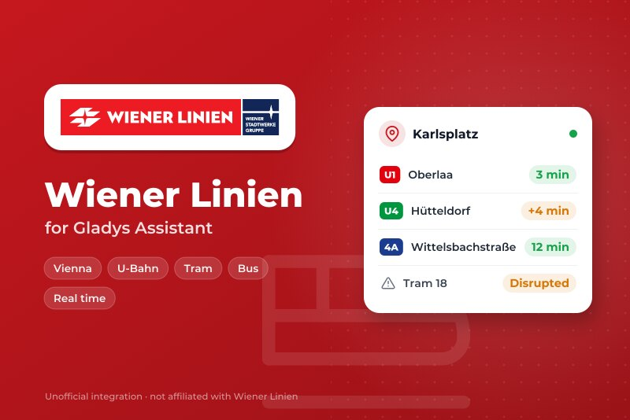
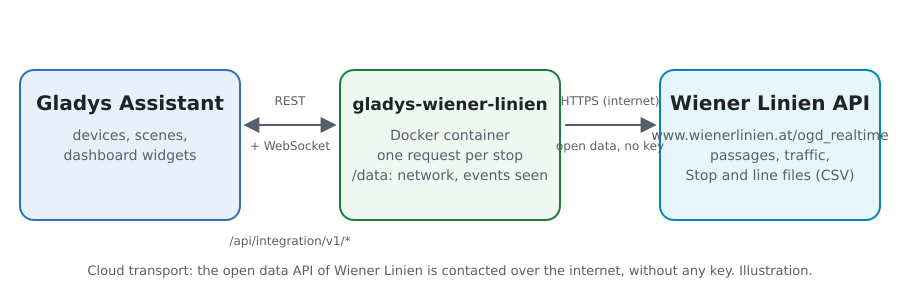
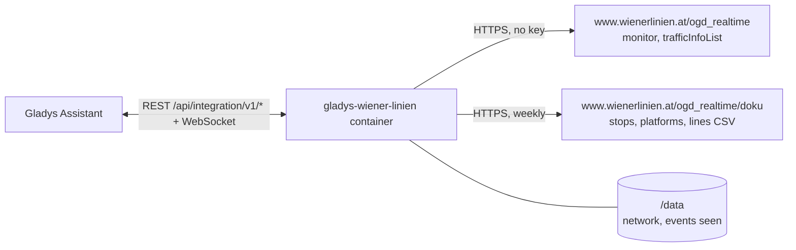
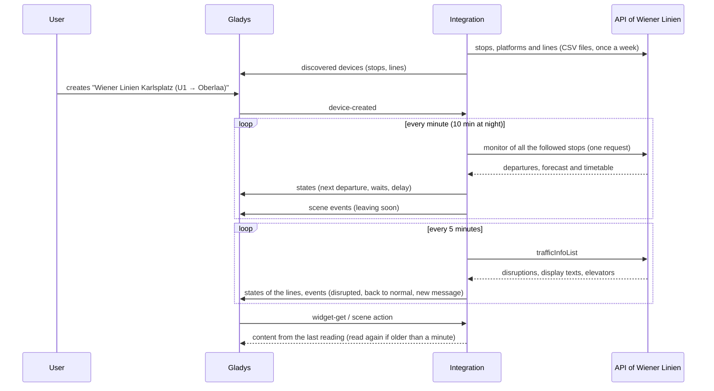
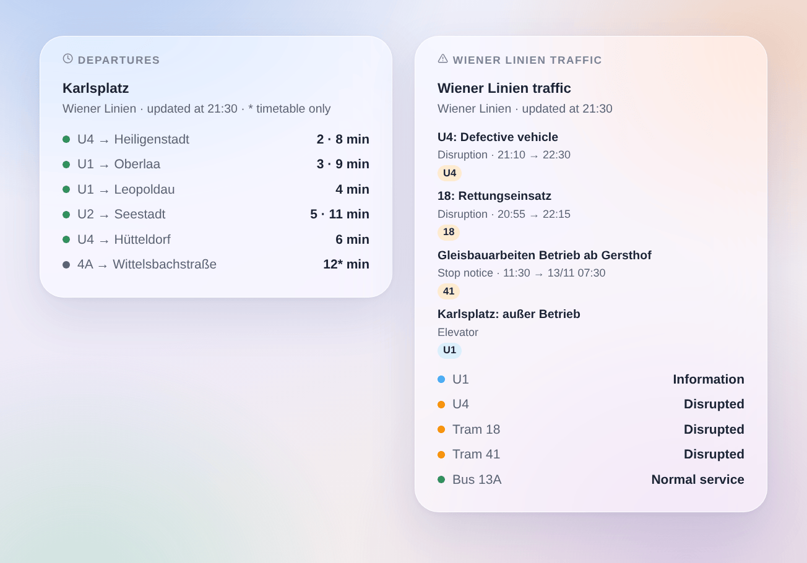

# Gladys Wiener Linien

**English** · [Français](README.fr.md) · [Deutsch](README.de.md) · [Español](README.es.md)

[](LICENSE)
[](https://github.com/William-De71/gladys-wiener-linien/releases)
[](https://github.com/William-De71/gladys-wiener-linien/actions/workflows/release.yml)
[](https://gladysassistant.com)



[Gladys Assistant](https://gladysassistant.com) external integration for **Wiener Linien**, the U-Bahn, trams and buses of Vienna: the next departures in real time at your stops, with their delay, and the traffic of your lines, with scenes and dashboard widgets. It reads the official real-time API of Wiener Linien, open data of the City of Vienna: no account, no key.

User documentation: [English](docs/en.md) · [Français](docs/fr.md) · [Deutsch](docs/de.md) · [Español](docs/es.md).

> Community integration, not affiliated with nor endorsed by Wiener Linien, Wiener Stadtwerke or the City of Vienna.

> Data source: City of Vienna – [data.wien.gv.at](https://data.wien.gv.at) (CC BY 4.0).

## Features

- **One device per followed stop** (three in the form, up to 7 more with the **Add a stop** button), typed by name or by number ("60200657" for the whole stop, a StopID for one platform) and filtered by **line** ("U1", "13A", "D", or "U-Bahn", "tram", "bus") and **direction**: next departure, wait of the next two departures, **delay** of the next one, number of traffic messages about the stop.
- **One device per followed line**: its traffic state (normal, information, disrupted, heavily disrupted) and its number of traffic messages.
- **Real time and delay**: the forecast when the vehicle is followed live, with its delay on the timetable; the timetable otherwise (marked as such).
- **Elevators out of service**, counted among the traffic messages when you ask for it (step-free access).
- **4 scene triggers**, **2 scene actions** and **2 dashboard widgets** (below).
- **Polite with the API**: one request for all the stops, answers kept 15 seconds, a pause of 5 minutes when the request limit is reached, fewer readings at night.
- **Stop search without asking the real-time API**: the names and numbers come from the open data files of Wiener Linien, read weekly and kept in `/data`.
- Configuration buttons: test the connection, find a stop, add / remove / list stops, diagnostic.
- Four languages everywhere: English, French, German, Spanish.

## How it works





At start, the integration reads the stops, platforms and lines of the open data files of Wiener Linien: a **DIVA number** ("60200657") is a whole stop, a **StopID** ("4120") one of its platforms. It resolves what you typed, then reads **all the followed stops in one request** (`monitor?diva=60200657&diva=60201510`) on its own timer, and the traffic of the network (`trafficInfoList`) every 5 minutes. Each reading is compared with the previous one to fire the scene triggers.



### Transport

Cloud only (`"transports": ["cloud"]`): the catalog shows the cloud badge. The integration contacts `www.wienerlinien.at` only, with the numbers of your stops. There is no local alternative, so there is no "prefer the local connection" button.

## Devices and features

| Device                             | Feature                      | Category / type              | Values                           |
| ---------------------------------- | ---------------------------- | ---------------------------- | -------------------------------- |
| Wiener Linien \<stop\>             | Next passage                 | `text` / `text`              | "U1 → Oberlaa · 3 min (+4 min)"  |
| Wiener Linien \<stop\>             | Wait, wait for the following | `duration` / `integer`       | 0 … 180 min                      |
| Wiener Linien \<stop\>             | Delay of the next passage    | `duration` / `integer`       | 0 … 180 min                      |
| Wiener Linien \<stop\>             | Traffic messages of the stop | `counter-sensor` / `integer` | 0 … 20                           |
| Wiener Linien U1, tram 18, bus 13A | Traffic                      | `text` / `text`              | "Disrupted: 18: Rettungseinsatz" |
| Wiener Linien U1, tram 18, bus 13A | Traffic messages             | `counter-sensor` / `integer` | 0 … 20                           |

At night, without any departure, the waits keep their last value (a 0 would announce a train now). The delay is published only for a departure followed live. The API lists no cancelled trip: the integration does not invent one.

## Scene triggers, actions and widgets



**Scene triggers** (once per transition; the first reading is a reference and fires nothing):

- **Departure soon**: a vehicle at a followed stop leaves in 2, 3, 5, 10, 15 or 20 minutes. Filters: stop, minutes. Variables: line, destination, time, real time, delay, summary.
- **Line disrupted**: a followed line becomes disrupted or heavily disrupted. Filter: line.
- **Back to normal**: a followed line that was disrupted is back to normal. Filter: line.
- **New traffic message**: a new message about a followed line or stop — a disruption of the control centre, a special text of a stop display, an elevator when followed; a disruption whose text changes fires again. Filters: line or stop, kind.

**Scene actions**: **next departures** of a stop (line, destination, wait, time, real time or not, delay, the following one, a sentence) and **traffic of a line** (state, disrupted or not, number of messages, latest message, a sentence).

**Widgets**: **Departures** (a followed stop, several in one list, or any stop typed in the settings) and **Wiener Linien traffic** (the followed lines, the lines typed, or the U-Bahn lines).

Examples:

- When **the U1 towards Oberlaa leaves Karlsplatz in 5 minutes** → light the hall lamp in green.
- When **the U4 becomes disrupted** → send `{{triggerEvent.data.summary}}` to your phone.
- Every weekday at 7:30 → **read the next departures** of your stop and have the `summary` spoken by the kitchen speaker.

## Requirements

- Gladys Assistant **5.3.0** or later (widgets and scene triggers of external integrations, catalog keywords and countries of Gladys 5.3). Older instances cannot install the integration.
- Internet access from the Gladys server. No account and no key.

## Installation

- **From the store** of Gladys (Integrations → External integrations), in one click, once indexed.
- **From the repository URL**: `https://github.com/William-De71/gladys-wiener-linien`.
- **Developer mode**: build the image locally (`docker build -t gladys-wiener-linien .`) and install it from Gladys.

## Configuration

| Field                 | Description                                                                     |
| --------------------- | ------------------------------------------------------------------------------- |
| Stop (1 to 3)         | A name ("Karlsplatz", "Stephansplatz") or a number ("60200657", or a StopID).   |
| Line                  | "U1", "13A", "D", or "U-Bahn", "tram", "bus". Empty: every line of the stop.    |
| Direction             | Words of the destination: "Oberlaa", "Oberlaa \| Reumannplatz". Empty: both.    |
| Followed lines        | "U1, U4, 13A, D" (up to 10): one device per line with its traffic.              |
| Follow the elevators  | Counts the elevators out of service among the traffic messages. Off by default. |
| Reading of the stops  | 30 s, 1 min (default), 2 min or 5 min; 10 min at night.                         |
| Language of the texts | Device names, scene summaries and outputs. The traffic messages stay in German. |

Buttons: **Test the connection**, **Find a stop** (from the open data files, without asking the real-time API), **Add a stop**, **Remove a stop**, **List the stops** (the stops beyond the three of the form, kept in the Gladys configuration) and **Diagnostic** (writes the stops, lines, last departures, traffic messages, errors and requests to the Logs tab).

## Usage

1. Enter one to three stops — more with **Add a stop** — (with their line and direction if you wish) and the lines to follow, then save. There is nothing else to configure.
2. In the **Discover** tab, create the "Wiener Linien …" devices.
3. Add the **Departures** and **Wiener Linien traffic** widgets to a dashboard, and build scenes with the triggers above.

## Development

```bash
npm install
npm test                       # node --test, never touches the network
npm run lint && npm run format:check
npx github:GladysAssistant/integration-store . --skip-image-check
scripts/build-cover.sh         # cover.jpg from docs/assets/cover.svg
docs/illustrations/render.sh   # docs/assets/widgets.<lang>.png
node .github/scripts/release.mjs next
```

Locally, the SDK reads `GLADYS_HOST_API_URL`, `GLADYS_INTEGRATION_TOKEN` and `GLADYS_INTEGRATION_SELECTOR`; `WL_API_URL` and `WL_DATA_URL` point the integration to other roots (a mock); `DEBUG=gladys-integration-sdk` shows the SDK logs and checks every widget content. The tests use answers built with the fields recorded from the real API and extracts of the real stop and line files (`test/fixtures/`, CC BY 4.0). The rules of the project are in [CLAUDE.md](CLAUDE.md).

## Release process


Every merge on `main` runs the CI, then computes the version from the [Conventional Commits](https://www.conventionalcommits.org/) since the last tag: `feat` → minor, `fix` / `perf` → patch, `!` or `BREAKING CHANGE` → major (a minor below 1.0.0); `docs`, `chore`, `ci`, `test`, `style`, `refactor`, `build` alone publish nothing. The changelog section is generated, the tag pushed, the multi-architecture image built, then `main` receives the release commit, the GitHub Release is created and a last job checks the public image, the store validator and the topic.

- The pull request title becomes the squash commit, then the changelog line: write it in English, for the user (`pr-title.yml` checks it). Never edit `CHANGELOG.md` by hand.
- 1.0.0 is a decision: Actions → Release → Run workflow with `release-as: 1.0.0`. `dry-run` shows the version and the notes without publishing.
- **Protected branch**: the release pushes its commit to `main` with `GITHUB_TOKEN`. With a ruleset on `main` stricter than "no deletion, no force-push", add GitHub Actions to its bypass list (or push through a GitHub App), otherwise the publish job fails with instructions.
- After the first release, make the `ghcr.io` package public (Package settings → Change visibility), or Gladys cannot pull it.

## Troubleshooting

See [docs/en.md](docs/en.md#troubleshooting). Report issues with the versions of Gladys and of the integration, the stop or line concerned, and the lines of the **Diagnostic** button.

## Contributing

Issues and pull requests are welcome. Run `npm run format:check && npm run lint && npm test` before opening a pull request, and keep every external id and stored key unchanged (see [CLAUDE.md](CLAUDE.md)).

## Security

See [SECURITY.md](SECURITY.md): report vulnerabilities privately. The integration holds no secret: the API is open and only receives the numbers of your stops. The container runs read-only, as a non-root user.

## Screenshots to come

The images above are illustrations, not screenshots. Real screenshots will go in `docs/assets/screenshots/` (PNG, 1280 × 800): `configuration.png`, `discovery.png`, `device.png`, `scene.png`.

## License

[Apache License 2.0](LICENSE) — see also [NOTICE](NOTICE). The departures, the traffic messages and the stops are open data of the City of Vienna under [CC BY 4.0](https://creativecommons.org/licenses/by/4.0/) — data source: City of Vienna – data.wien.gv.at: the widgets show the source and the time of each reading. Thanks to the Gladys documentation and SDK, and to Wiener Linien for opening their real-time API.
