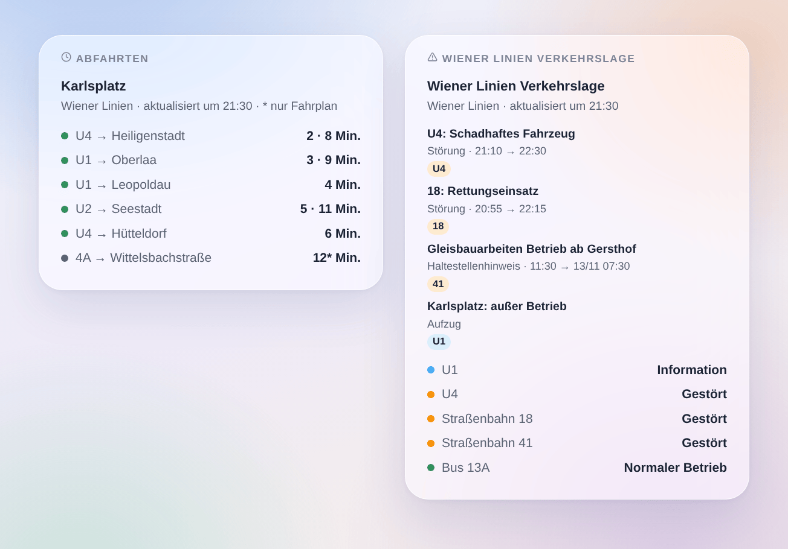

# Wiener Linien

## Überblick

Diese Integration bringt **U-Bahn, Straßenbahn und Bus in Wien** (Wiener Linien) in Gladys. Sie liefert die **nächsten Abfahrten in Echtzeit** an den Haltestellen deiner Wahl (drei im Formular, bis zu 7 weitere per Schaltfläche), gefiltert nach Linie und Richtung, samt **Verspätung**, und die **Verkehrslage der Linien**, die du verfolgst: normaler Betrieb, gestört, stark gestört, mit den Meldungen der Wiener Linien. Jede Haltestelle und jede Linie wird ein Gerät für das Dashboard und für Szenen.

Die Daten stammen aus der **offiziellen Echtzeit-Schnittstelle der Wiener Linien**, Open Data der Stadt Wien (CC BY 4.0). **Weder Konto noch Schlüssel** sind nötig. Die Namen der Haltestellen und Linien stammen aus den Open-Data-Dateien der Wiener Linien, einmal pro Woche gelesen: Die Haltestellensuche fragt die Echtzeit-Schnittstelle nicht ab.

Alle verfolgten Haltestellen werden in **einer einzigen Anfrage** gelesen, standardmäßig jede Minute; die Verkehrslage alle 5 Minuten. Meldet die Schnittstelle, dass ihr Abfragelimit erreicht ist, pausiert die Integration 5 Minuten. Nachts, solange keine Haltestelle in den nächsten 45 Minuten etwas ankündigt, werden die Haltestellen alle 10 Minuten gelesen.

Eine Abfahrt wird **in Echtzeit verfolgt**, wenn die Wiener Linien eine Prognose dafür veröffentlichen; dann kennt die Integration ihre **Verspätung** gegenüber dem Fahrplan. Sonst gilt die **Fahrplanzeit**, gekennzeichnet mit „(Fahrplan)“ (ein Stern im Widget). Die Schnittstelle nennt keine ausgefallenen Fahrten: Die Integration erfindet keine.

Dies ist eine **Cloud**-Integration: Sie kontaktiert ausschließlich `www.wienerlinien.at`, mit den Nummern deiner Haltestellen. Sonst verlässt nichts dein Netzwerk.

Datenquelle: Stadt Wien – [data.wien.gv.at](https://data.wien.gv.at).

## Voraussetzungen

- Gladys Assistant 5.3.0 oder neuer.
- Internetzugang vom Gladys-Server. Kein Konto, kein Schlüssel.

## Konfiguration

| Feld                     | Was einzugeben ist                                                                                                           |
| ------------------------ | ---------------------------------------------------------------------------------------------------------------------------- |
| Haltestelle 1, 2, 3      | Der Name („Karlsplatz“, „Stephansplatz“) oder die Nummer: „60200657“ für die ganze Haltestelle, eine StopID für einen Steig. |
| Linie                    | Nur diese Linie: „U1“, „13A“, „D“ oder nur ein Verkehrsmittel: „U-Bahn“, „Tram“, „Bus“. Leer: alle Linien.                   |
| Richtung                 | Nur Ziele mit diesen Wörtern: „Oberlaa“, „Oberlaa \| Reumannplatz“. Leer: beide Richtungen.                                  |
| Verfolgte Linien         | Die Linien, deren Verkehrslage du verfolgst, durch Kommas getrennt: „U1, U4, 13A, D“ (höchstens 10). Ein Gerät pro Linie.    |
| Aufzüge verfolgen        | Zählt Aufzüge außer Betrieb zu den Verkehrsmeldungen deiner Haltestellen und Linien. Standardmäßig aus.                      |
| Abfrage der Haltestellen | Alle 30 Sekunden, jede Minute (Standard), alle 2 oder 5 Minuten.                                                             |
| Sprache der Texte        | Namen der Geräte, Zusammenfassungen und Ausgaben der Szenen.                                                                 |

Die Schaltfläche **Haltestelle suchen** zeigt die Haltestellen mit einigen Wörtern samt Nummer: „Karlsplatz [60200657]“. Diese Nummer (die „DIVA“-Nummer) steht für die ganze Haltestelle mit allen Steigen und Linien. Ein Haltestellenname wird auch so akzeptiert, wie die Anzeigen ihn schreiben („Karlsplatz U“). Um nur einen Steig zu verfolgen, gib seine **StopID** ein (die frühere „RBL-Nummer“, zum Beispiel „4120“ für die U1 Richtung Oberlaa am Karlsplatz); Linie und Richtung erreichen dasselbe einfacher. **Verbindung testen** liest sofort die Haltestellen und Linien der Wiener Linien, jede verfolgte Haltestelle und die Verkehrslage und meldet, was geantwortet hat.

Mehr Haltestellen als die drei im Formular (Zuhause, Arbeit, Schule…): **Haltestelle hinzufügen** nimmt dieselben drei Felder – Haltestelle, Linie, Richtung – und verfolgt bis zu 7 weitere. **Haltestellen auflisten** zeigt alle verfolgten Haltestellen nummeriert; **Haltestelle entfernen** nimmt diese Nummer (oder den Namen). Die hinzugefügten Haltestellen liegen in der Konfiguration von Gladys und sind damit Teil ihrer Backups.

## Verwendung

### Geräte

Erstelle im Tab **Entdecken** die gewünschten Geräte:

- **Wiener Linien \<Haltestelle\>**: die nächste Abfahrt als Text („U1 → Oberlaa · 3 Min.“, „(+4 Min.)“ ab 2 Minuten Verspätung), die Wartezeit der nächsten und der folgenden Abfahrt (Minuten), die **Verspätung** der nächsten Abfahrt (Minuten, 0 wenn pünktlich) und die Zahl der laufenden Verkehrsmeldungen zur Haltestelle. Nachts, ohne Abfahrt, behalten die Wartezeiten ihren letzten Wert.
- **Wiener Linien U1**, **Wiener Linien Straßenbahn 18**, **Wiener Linien Bus 13A**: die Verkehrslage der Linie als Text („Gestört: 18: Rettungseinsatz“) und die Zahl ihrer laufenden Verkehrsmeldungen.

### Verkehrslage der Linien und Haltestellen

Die Wiener Linien veröffentlichen drei Arten von Meldungen:

- eine **Störung**, von der Leitstelle für eine oder mehrere Linien verfasst („18: Rettungseinsatz“): Die Linie ist gestört, stark gestört, wenn der Text sagt, dass sie nicht fährt („kein Betrieb“, „eingestellt“, „unterbrochen“, „gesperrt“);
- ein **Haltestellenhinweis**, der Sondertext auf der Anzeige eines Steigs („Gleisbauarbeiten – Betrieb ab Knöllgasse“): Er zählt für diese Haltestelle und für ihre Linie höchstens als Störung;
- ein **Aufzug** außer Betrieb, nur wenn **Aufzüge verfolgen** eingeschaltet ist: eine Information, der Betrieb bleibt normal.

Das Gerät einer Linie zeigt die schwerste laufende Meldung. Das Gerät einer Haltestelle zählt die Störungen der dort haltenden Linien (gemäß Linien- und Richtungsfilter) sowie die Hinweise und Aufzüge der eigenen Steige. Die Meldungen verfassen die Wiener Linien auf Deutsch; einige Störungen gibt es auch auf Englisch, angezeigt, wenn Gladys auf Englisch läuft.

### Dashboard-Widgets

- **Abfahrten**: die nächsten Abfahrten einer Haltestelle, kompakt. Eine Zeile pro Linie und Ziel mit ihren nächsten Abfahrten hintereinander („3 · 9 Min.“); ein Stern kennzeichnet eine reine Fahrplanzeit. Die Einstellung **Angezeigte Fahrten** legt die Zeilenzahl fest. Wähle eine verfolgte Haltestelle oder gib in den Widget-Einstellungen eine beliebige Haltestelle (und eine Linie) ein: Eine solche Haltestelle kostet bei jeder Aktualisierung eine zusätzliche Anfrage, höchstens jede Minute. Mit **Mehrere Haltestellen** zeigt ein Widget mehrere Haltestellen-Geräte.
- **Wiener Linien Verkehrslage**: der Zustand der verfolgten Linien (oder der in den Einstellungen eingegebenen Linien oder der U-Bahn-Linien, wenn keine verfolgt wird), dann ihre laufenden und kommenden Meldungen. Tippe auf eine Karte für den vollständigen Text.

### Szenen

Auslöser, einmal pro Änderung (die erste Abfrage dient nur als Referenz):

- **Wiener Linien: Abfahrt bald**: Ein Fahrzeug an einer verfolgten Haltestelle fährt in 2, 3, 5, 10, 15 oder 20 Minuten ab.
- **Wiener Linien: Linie gestört**: Eine verfolgte Linie wird gestört oder stark gestört.
- **Wiener Linien: wieder normal**: Eine verfolgte Linie, die gestört war, fährt wieder normal.
- **Wiener Linien: neue Verkehrsmeldung**: eine neue Meldung zu einer verfolgten Linie oder Haltestelle; Filter nach Art (Störung, Haltestellenhinweis, Aufzug). Eine Störung mit geändertem Text löst erneut aus.

Jeder liefert einen fertigen Satz, `{{triggerEvent.data.summary}}`, und seine Werte (Linie, Ziel, Uhrzeit, Verspätung, Titel, Text…). Die Aktionen **Wiener Linien: nächste Abfahrten** und **Wiener Linien: Verkehrslage einer Linie** geben dieselbe Art von Werten zurück – für eine Nachricht oder eine Bedingung.

Beispiele:

- Wenn die U1 Richtung Oberlaa in 5 Minuten am Karlsplatz abfährt → die Flurlampe auf Grün schalten.
- Wenn die U4 gestört wird → die Zusammenfassung vor dem Losgehen aufs Handy schicken.
- Jeden Werktag um 7:30 Uhr → die nächsten Abfahrten deiner Haltestelle lesen und vom Küchenlautsprecher ansagen lassen, mit Verspätung.

### Transport

Nur Cloud: Die Daten kommen aus dem Internet. Nur die Haltestellen, die du verfolgst, werden bei der Schnittstelle abgefragt, in einer Anfrage, dazu die Verkehrslage des Netzes alle 5 Minuten.

## Fehlerbehebung

- **„Bereit. Füge … eine Haltestelle oder Linie hinzu“**: Noch wird nichts verfolgt; trage eine Haltestelle oder Linie ein und speichere.
- **„Die API der Wiener Linien bittet um weniger Anfragen“**: Die Schnittstelle meldet, dass ihr Abfragelimit erreicht ist (Code 316); die Abfragen laufen nach 5 Minuten weiter. Wähle ein längeres Intervall.
- **„Die API der Wiener Linien antwortet nicht“**: Der Server ist nicht erreichbar oder in Wartung; die letzten Werte bleiben, und die Integration versucht es im nächsten Intervall erneut.
- **„Unbekannt oder mehrdeutig“**: Nutze **Haltestelle suchen** und übernimm den genauen Namen oder die Nummer.
- **Zwei Haltestellen gleichen Namens** (zwei „Kirchengasse“): Der Name verfolgt beide; gib die Nummer der gewünschten ein.
- **„(Fahrplan)“ hinter einer Abfahrt**: Die Wiener Linien veröffentlichen für dieses Fahrzeug keine Prognose; es gilt die Fahrplanzeit, eine Verspätung ist nicht bekannt.
- **Keine Abfahrt**: Die Schnittstelle kündigt nur die nächsten 70 Minuten an; nachts werden die Haltestellen alle 10 Minuten gelesen.
- **Ein Problem melden**: Drücke **Diagnose** und kopiere die Zeilen, die mit „Wiener Linien diagnostic“ beginnen, aus dem Tab Protokolle in ein GitHub-Issue oder eine Antwort im Forum, mit den Versionen von Gladys und der Integration.
