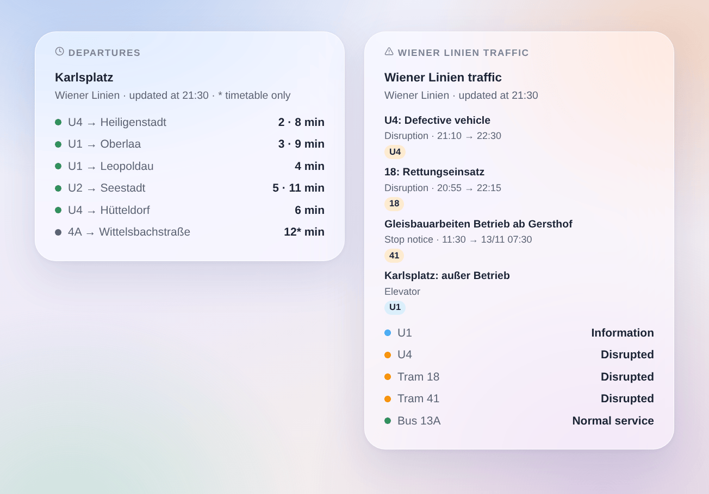

# Wiener Linien

## Overview

This integration brings the **U-Bahn, trams and buses of Vienna** (Wiener Linien) into Gladys. It gives the **next departures in real time** at the stops you choose (three in the form, up to 7 more with a button), filtered by line and direction, with their **delay**, and the **traffic of the lines** you follow: normal service, disrupted, heavily disrupted, with the messages of Wiener Linien. Each stop and each line becomes a device to show on a dashboard and to use in scenes.

The data come from the **official real-time API of Wiener Linien**, open data of the City of Vienna (CC BY 4.0). **No account and no key** are needed. The names of the stops and lines come from the open data files of Wiener Linien, read once a week: finding a stop asks nothing to the real-time API.

All the followed stops are read in **one request**, every minute by default; the traffic is read every 5 minutes. The integration pauses 5 minutes if the API says its request limit is reached. At night, while no stop announces anything in the next 45 minutes, the stops are read every 10 minutes.

A departure is **followed in real time** when Wiener Linien publish a forecast for it; the integration then knows its **delay** on the timetable. Otherwise it is the **timetable** time, marked "(timetable)" (a star in the widget). The API lists no cancelled trip: the integration never invents one.

This is a **cloud** integration: it contacts `www.wienerlinien.at` only, with the numbers of your stops. Nothing else leaves your network.

Data source: City of Vienna – [data.wien.gv.at](https://data.wien.gv.at).

## Requirements

- Gladys Assistant 5.3.0 or later.
- Internet access from the Gladys server. No account, no key.

## Configuration

| Field                 | What to type                                                                                                                  |
| --------------------- | ----------------------------------------------------------------------------------------------------------------------------- |
| Stop 1, 2, 3          | The name of the stop ("Karlsplatz", "Stephansplatz") or its number: "60200657" for the whole stop, a StopID for one platform. |
| Line                  | Only this line: "U1", "13A", "D", or a mode alone: "U-Bahn", "tram", "bus". Empty: every line of the stop.                    |
| Direction             | Only the destinations holding these words: "Oberlaa", "Oberlaa \| Reumannplatz". Empty: both directions.                      |
| Followed lines        | The lines whose traffic you follow, separated by commas: "U1, U4, 13A, D" (up to 10). One device per line.                    |
| Follow the elevators  | Counts the elevators out of service among the traffic messages of your stops and lines. Off by default.                       |
| Reading of the stops  | Every 30 seconds, minute (default), 2 minutes or 5 minutes.                                                                   |
| Language of the texts | Names of the devices, summaries and outputs of the scenes.                                                                    |

The **Find a stop** button gives the stops holding a few words, with their number: "Karlsplatz [60200657]". That number (the "DIVA" number) is the whole stop, every platform and line. A stop name is also accepted as the displays write it ("Karlsplatz U"). To follow a single platform, type its **StopID** (the former "RBL number", for example "4120" for the U1 towards Oberlaa at Karlsplatz); a line and a direction do the same job more simply. **Test the connection** reads the stops and lines of Wiener Linien, each followed stop and the traffic right away, and says what answered.

More stops than the three of the form (home, work, school…): **Add a stop** takes the same three fields — stop, line, direction — and follows up to 7 more stops. **List the stops** shows every followed stop, numbered; **Remove a stop** takes that number (or the name). The added stops are kept in the configuration of Gladys, so they follow its backups.

## Usage

### Devices

In the **Discover** tab, create the devices you want:

- **Wiener Linien \<stop\>**: the next departure as text ("U1 → Oberlaa · 3 min", "(+4 min)" when it runs at least 2 minutes late), the wait of the next departure and of the one after (minutes), the **delay** of the next departure (minutes, 0 when on time) and the number of traffic messages under way about the stop. At night, without any departure, the waits keep their last value.
- **Wiener Linien U1**, **Wiener Linien tram 18**, **Wiener Linien bus 13A**: the traffic of the line as text ("Disrupted: 18: Rettungseinsatz") and its number of traffic messages under way.

### Traffic of the lines and stops

Wiener Linien publish three kinds of messages:

- a **disruption**, written by the control centre for one or more lines ("18: Rettungseinsatz"): the line is disrupted, heavily disrupted when the text says it does not run ("kein Betrieb", "eingestellt", "unterbrochen", "gesperrt");
- a **stop notice**, the special text shown on the display of a platform ("Gleisbauarbeiten – Betrieb ab Knöllgasse"): it counts for that stop, and for its line as a disruption at most;
- an **elevator** out of service, only when **Follow the elevators** is on: an information, the service stays normal.

A line device shows the heaviest message under way. A stop device counts the disruptions of the lines calling there (as filtered by line and direction) and the notices and elevators of its own platforms. The messages are written in German by Wiener Linien; a few disruptions also exist in English, shown when Gladys is in English.

### Dashboard widgets

- **Departures**: the next departures of a stop, compact. One row per line and destination, with its next departures in a row ("3 · 9 min"); a star marks a time of the timetable only. The **Routes shown** setting sets the number of rows. Choose a followed stop, or type any stop (and a line) in the widget settings: such a stop costs one more request at each refresh, every minute at most. With **Several stops**, one widget shows several stop devices.
- **Wiener Linien traffic**: the state of the followed lines (or of the lines typed in the settings, or the U-Bahn lines when none is followed), then their messages under way and coming. Tap a card for the full text.

### Scenes

Triggers, once per change (the first reading is only a baseline):

- **Wiener Linien: departure soon**: a vehicle at a followed stop leaves in 2, 3, 5, 10, 15 or 20 minutes.
- **Wiener Linien: line disrupted**: a followed line becomes disrupted or heavily disrupted.
- **Wiener Linien: back to normal**: a followed line that was disrupted is back to normal.
- **Wiener Linien: new traffic message**: a new message about a followed line or stop; filter by kind (disruption, stop notice, elevator). A disruption whose text changes fires again.

Each gives a ready-made sentence, `{{triggerEvent.data.summary}}`, and its values (line, destination, time, delay, title, text…). The actions **Wiener Linien: next departures** and **Wiener Linien: traffic of a line** return the same kind of values, to put in a message or to test in a condition.

Examples:

- When the U1 towards Oberlaa leaves Karlsplatz in 5 minutes → turn the hall lamp green.
- When the U4 becomes disrupted → send the summary to your phone before you leave.
- Every weekday at 7:30 → read the next departures of your stop and have the kitchen speaker announce them, with the delay.

### Transport

Cloud only: the data come from the internet. Only the stops you follow are asked to the API, in one request, and the traffic of the network every 5 minutes.

## Troubleshooting

- **"Ready. Add a stop or a line"**: nothing is followed yet; fill in a stop or a line and save.
- **"The Wiener Linien API asks to slow down"**: the API answered that its request limit is reached (code 316); the readings resume after 5 minutes. Choose a longer interval.
- **"The Wiener Linien API does not answer"**: the server is out of reach or under maintenance; the last readings stay and the integration tries again at the next interval.
- **"Unknown or ambiguous"**: use **Find a stop**, then copy the exact name or the number.
- **Two stops of the same name** (two "Kirchengasse"): the name follows both; type the number of the one you want.
- **"(timetable)" after a departure**: Wiener Linien publish no forecast for that vehicle; the time is the one of the timetable and no delay is known.
- **No departure**: the API announces the next 70 minutes only; at night the stops are read every 10 minutes.
- **To report a problem**: press **Diagnostic**, then copy the lines starting with "Wiener Linien diagnostic" from the Logs tab into a GitHub issue or a reply on the forum, with the versions of Gladys and of the integration.
