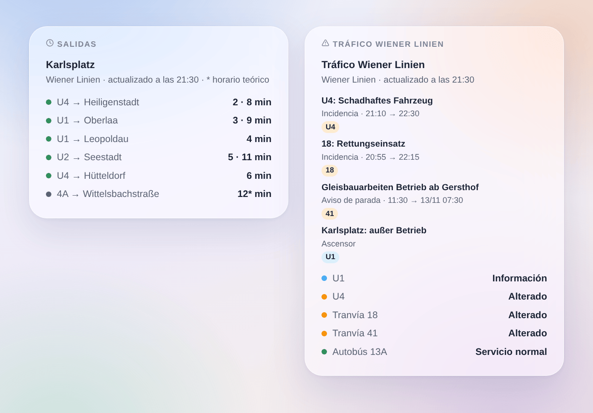

# Wiener Linien

## Presentación

Esta integración lleva el **metro (U-Bahn), los tranvías y los autobuses de Viena** (Wiener Linien) a Gladys. Ofrece los **próximos pasos en tiempo real** en las paradas que elijas (tres en el formulario, hasta 7 más con un botón), filtrados por línea y dirección, con su **retraso**, y el **tráfico de las líneas** que sigues: servicio normal, alterado, muy alterado, con los avisos de Wiener Linien. Cada parada y cada línea se convierte en un dispositivo para mostrar en un panel y usar en escenas.

Los datos vienen de la **API oficial en tiempo real de Wiener Linien**, datos abiertos de la Ciudad de Viena (CC BY 4.0). **No hace falta cuenta ni clave**. Los nombres de las paradas y líneas vienen de los archivos open data de Wiener Linien, leídos una vez por semana: buscar una parada no pide nada a la API en tiempo real.

Todas las paradas seguidas se leen en **una sola petición**, cada minuto por defecto; el tráfico se lee cada 5 minutos. La integración hace una pausa de 5 minutos si la API indica que se ha alcanzado su límite de peticiones. De noche, mientras ninguna parada anuncie nada en los próximos 45 minutos, las paradas se leen cada 10 minutos.

Un paso se **sigue en tiempo real** cuando Wiener Linien publica una previsión para él; la integración conoce entonces su **retraso** sobre el horario. Si no, es la hora del **horario teórico**, marcada «(teórico)» (una estrella en el widget). La API no lista ningún servicio suprimido: la integración nunca inventa uno.

Es una integración **cloud**: solo contacta con `www.wienerlinien.at`, con los números de tus paradas. Nada más sale de tu red.

Fuente de los datos: Ciudad de Viena – [data.wien.gv.at](https://data.wien.gv.at).

## Requisitos

- Gladys Assistant 5.3.0 o posterior.
- Acceso a Internet desde el servidor de Gladys. Sin cuenta, sin clave.

## Configuración

| Campo                  | Qué escribir                                                                                                                 |
| ---------------------- | ---------------------------------------------------------------------------------------------------------------------------- |
| Parada 1, 2, 3         | El nombre de la parada («Karlsplatz», «Stephansplatz») o su número: «60200657» para toda la parada, un StopID para un andén. |
| Línea                  | Solo esta línea: «U1», «13A», «D», o solo un modo: «U-Bahn», «tram», «bus». Vacío: todas las líneas de la parada.            |
| Dirección              | Solo los destinos que contienen estas palabras: «Oberlaa», «Oberlaa \| Reumannplatz». Vacío: ambos sentidos.                 |
| Líneas seguidas        | Las líneas cuyo tráfico sigues, separadas por comas: «U1, U4, 13A, D» (10 como máximo). Un dispositivo por línea.            |
| Seguir los ascensores  | Cuenta los ascensores fuera de servicio entre los avisos de tráfico de tus paradas y líneas. Desactivado por defecto.        |
| Lectura de las paradas | Cada 30 segundos, cada minuto (por defecto), cada 2 o 5 minutos.                                                             |
| Idioma de los textos   | Nombres de los dispositivos, resúmenes y salidas de las escenas.                                                             |

El botón **Buscar una parada** da las paradas que contienen unas palabras, con su número: «Karlsplatz [60200657]». Ese número (el número «DIVA») es toda la parada, con todos sus andenes y líneas. También se acepta el nombre de una parada tal como lo escriben las pantallas («Karlsplatz U»). Para seguir un solo andén, escribe su **StopID** (el antiguo «número RBL», por ejemplo «4120» para la U1 hacia Oberlaa en Karlsplatz); una línea y una dirección hacen lo mismo de forma más sencilla. **Probar la conexión** lee al momento las paradas y líneas de Wiener Linien, cada parada seguida y el tráfico, y dice qué ha respondido.

Más paradas que las tres del formulario (casa, trabajo, colegio…): **Añadir una parada** toma los mismos tres campos — parada, línea, dirección — y sigue hasta 7 paradas más. **Listar las paradas** muestra todas las paradas seguidas, numeradas; **Quitar una parada** toma ese número (o el nombre). Las paradas añadidas se guardan en la configuración de Gladys, así que siguen sus copias de seguridad.

## Uso

### Dispositivos

En la pestaña **Descubrir**, crea los dispositivos que quieras:

- **Wiener Linien \<parada\>**: el próximo paso en texto («U1 → Oberlaa · 3 min», «(+4 min)» cuando lleva al menos 2 minutos de retraso), la espera del próximo paso y del siguiente (minutos), el **retraso** del próximo paso (minutos, 0 si va puntual) y el número de avisos de tráfico en curso sobre la parada. De noche, sin ningún paso, las esperas conservan su último valor.
- **Wiener Linien U1**, **Wiener Linien tranvía 18**, **Wiener Linien autobús 13A**: el tráfico de la línea en texto («Alterado: 18: Rettungseinsatz») y su número de avisos de tráfico en curso.

### Tráfico de las líneas y paradas

Wiener Linien publica tres tipos de avisos:

- una **incidencia**, redactada por el centro de control para una o varias líneas («18: Rettungseinsatz»): la línea está alterada, muy alterada cuando el texto dice que no circula («kein Betrieb», «eingestellt», «unterbrochen», «gesperrt»);
- un **aviso de parada**, el texto especial que muestra la pantalla de un andén («Gleisbauarbeiten – Betrieb ab Knöllgasse»): cuenta para esa parada, y para su línea como una incidencia como máximo;
- un **ascensor** fuera de servicio, solo cuando **Seguir los ascensores** está activado: una información, el servicio sigue normal.

El dispositivo de una línea muestra el aviso en curso más grave. El dispositivo de una parada cuenta las incidencias de las líneas que pasan por ella (según el filtro de línea y dirección) y los avisos y ascensores de sus propios andenes. Wiener Linien redacta los avisos en alemán; algunas incidencias existen también en inglés, mostradas cuando Gladys está en inglés.

### Widgets del panel

- **Salidas**: los próximos pasos de una parada, en compacto. Una fila por línea y destino, con sus próximos pasos seguidos («3 · 9 min»); una estrella marca una hora del horario teórico. El ajuste **Trayectos mostrados** fija el número de filas. Elige una parada seguida, o escribe cualquier parada (y una línea) en los ajustes del widget: una parada así cuesta una petición más en cada actualización, como mucho cada minuto. Con **Varias paradas**, un solo widget muestra varios dispositivos de parada.
- **Tráfico Wiener Linien**: el estado de las líneas seguidas (o de las líneas escritas en los ajustes, o de las líneas de metro cuando no se sigue ninguna), y luego sus avisos en curso y próximos. Toca una tarjeta para ver el texto completo.

### Escenas

Disparadores, una vez por cambio (la primera lectura solo sirve de referencia):

- **Wiener Linien: salida en breve**: un vehículo de una parada seguida sale dentro de 2, 3, 5, 10, 15 o 20 minutos.
- **Wiener Linien: línea alterada**: una línea seguida pasa a estar alterada o muy alterada.
- **Wiener Linien: fin de la incidencia**: una línea seguida que estaba alterada vuelve a la normalidad.
- **Wiener Linien: nuevo aviso de tráfico**: un nuevo aviso sobre una línea o parada seguida; filtro por tipo (incidencia, aviso de parada, ascensor). Una incidencia cuyo texto cambia se dispara de nuevo.

Cada uno da una frase lista para usar, `{{triggerEvent.data.summary}}`, y sus valores (línea, destino, hora, retraso, título, texto…). Las acciones **Wiener Linien: próximas salidas** y **Wiener Linien: tráfico de una línea** devuelven el mismo tipo de valores, para poner en un mensaje o comprobar en una condición.

Ejemplos:

- Cuando la U1 hacia Oberlaa sale de Karlsplatz dentro de 5 minutos → poner en verde la lámpara de la entrada.
- Cuando la U4 pasa a estar alterada → enviar el resumen a tu teléfono antes de salir.
- Cada día laborable a las 7:30 → leer los próximos pasos de tu parada y hacer que el altavoz de la cocina los anuncie, con el retraso.

### Transporte

Solo cloud: los datos vienen de Internet. Solo se piden a la API las paradas que sigues, en una petición, y el tráfico de la red cada 5 minutos.

## Solución de problemas

- **«Listo. Añade una parada o una línea»**: aún no se sigue nada; rellena una parada o una línea y guarda.
- **«La API de Wiener Linien pide reducir el ritmo»**: la API ha respondido que se alcanzó su límite de peticiones (código 316); las lecturas se reanudan tras 5 minutos. Elige un intervalo más largo.
- **«La API de Wiener Linien no responde»**: el servidor no está accesible o está en mantenimiento; las últimas lecturas se conservan y la integración lo intenta de nuevo en el siguiente intervalo.
- **«Desconocido o ambiguo»**: usa **Buscar una parada** y copia el nombre exacto o el número.
- **Dos paradas con el mismo nombre** (dos «Kirchengasse»): el nombre sigue ambas; escribe el número de la que quieras.
- **«(teórico)» tras un paso**: Wiener Linien no publica previsión para ese vehículo; la hora es la del horario y no se conoce retraso.
- **Ningún paso**: la API solo anuncia los próximos 70 minutos; de noche las paradas se leen cada 10 minutos.
- **Para informar de un problema**: pulsa **Diagnóstico** y copia las líneas que empiezan por «Wiener Linien diagnostic» de la pestaña Registros en una issue de GitHub o una respuesta en el foro, con las versiones de Gladys y de la integración.
