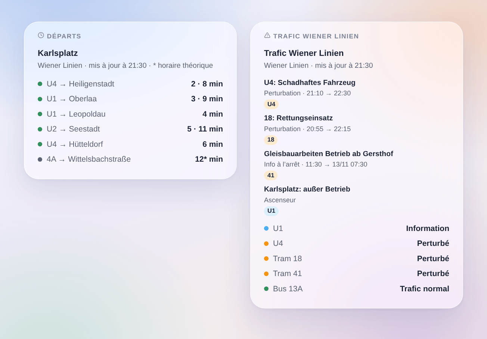

# Wiener Linien

## Présentation

Cette intégration fait entrer le **métro (U-Bahn), les trams et les bus de Vienne** (Wiener Linien) dans Gladys. Elle donne les **prochains passages en temps réel** aux arrêts de votre choix (trois dans le formulaire, jusqu’à 7 de plus par un bouton), filtrés par ligne et par direction, avec leur **retard**, et le **trafic des lignes** que vous suivez : trafic normal, perturbé, très perturbé, avec les messages des Wiener Linien. Chaque arrêt et chaque ligne devient un appareil à afficher sur un tableau de bord et à utiliser dans les scènes.

Les données viennent de l’**API temps réel officielle des Wiener Linien**, données ouvertes de la Ville de Vienne (CC BY 4.0). **Ni compte ni clé** ne sont nécessaires. Les noms des arrêts et des lignes viennent des fichiers open data des Wiener Linien, lus une fois par semaine : chercher un arrêt ne demande rien à l’API temps réel.

Tous les arrêts suivis sont lus en **une seule requête**, chaque minute par défaut ; le trafic est lu toutes les 5 minutes. L’intégration fait une pause de 5 minutes si l’API annonce que sa limite de requêtes est atteinte. La nuit, tant qu’aucun arrêt n’annonce rien dans les 45 prochaines minutes, les arrêts sont lus toutes les 10 minutes.

Un passage est **suivi en temps réel** quand les Wiener Linien publient une prévision pour lui ; l’intégration connaît alors son **retard** sur l’horaire. Sinon c’est l’heure de l’**horaire théorique**, marquée « (théorique) » (une étoile dans le widget). L’API ne liste aucune course supprimée : l’intégration n’en invente jamais.

C’est une intégration **cloud** : elle contacte uniquement `www.wienerlinien.at`, avec les numéros de vos arrêts. Rien d’autre ne sort de votre réseau.

Source des données : Ville de Vienne – [data.wien.gv.at](https://data.wien.gv.at).

## Prérequis

- Gladys Assistant 5.3.0 ou plus récent.
- Un accès à Internet depuis le serveur Gladys. Ni compte, ni clé.

## Configuration

| Champ                 | Quoi saisir                                                                                                                   |
| --------------------- | ----------------------------------------------------------------------------------------------------------------------------- |
| Arrêt 1, 2, 3         | Le nom de l’arrêt (« Karlsplatz », « Stephansplatz ») ou son numéro : « 60200657 » pour tout l’arrêt, un StopID pour un quai. |
| Ligne                 | Seulement cette ligne : « U1 », « 13A », « D », ou un mode seul : « U-Bahn », « tram », « bus ». Vide : toutes les lignes.    |
| Direction             | Seulement les destinations contenant ces mots : « Oberlaa », « Oberlaa \| Reumannplatz ». Vide : les deux sens.               |
| Lignes suivies        | Les lignes dont vous suivez le trafic, séparées par des virgules : « U1, U4, 13A, D » (10 au plus). Un appareil par ligne.    |
| Suivre les ascenseurs | Compte les ascenseurs hors service parmi les messages de trafic de vos arrêts et lignes. Désactivé par défaut.                |
| Lecture des arrêts    | Toutes les 30 secondes, chaque minute (par défaut), toutes les 2 ou 5 minutes.                                                |
| Langue des textes     | Noms des appareils, résumés et sorties des scènes.                                                                            |

Le bouton **Chercher un arrêt** donne les arrêts contenant quelques mots, avec leur numéro : « Karlsplatz [60200657] ». Ce numéro (le numéro « DIVA ») désigne tout l’arrêt, tous ses quais et ses lignes. Un nom d’arrêt est aussi accepté tel que les afficheurs l’écrivent (« Karlsplatz U »). Pour suivre un seul quai, saisissez son **StopID** (l’ancien « numéro RBL », par exemple « 4120 » pour la U1 vers Oberlaa à Karlsplatz) ; une ligne et une direction font la même chose plus simplement. **Tester la connexion** lit tout de suite les arrêts et lignes des Wiener Linien, chaque arrêt suivi et le trafic, et dit ce qui a répondu.

Plus d’arrêts que les trois du formulaire (maison, travail, école…) : **Ajouter un arrêt** prend les trois mêmes champs — arrêt, ligne, direction — et suit jusqu’à 7 arrêts de plus. **Lister les arrêts** montre tous les arrêts suivis, numérotés ; **Retirer un arrêt** prend ce numéro (ou le nom). Les arrêts ajoutés sont gardés dans la configuration de Gladys : ils suivent donc ses sauvegardes.

## Utilisation

### Appareils

Dans l’onglet **Découvrir**, créez les appareils voulus :

- **Wiener Linien \<arrêt\>** : le prochain passage en texte (« U1 → Oberlaa · 3 min », « (+4 min) » quand il a au moins 2 minutes de retard), l’attente du prochain passage et du suivant (minutes), le **retard** du prochain passage (minutes, 0 quand il est à l’heure) et le nombre de messages de trafic en cours sur l’arrêt. La nuit, sans aucun passage, les attentes gardent leur dernière valeur.
- **Wiener Linien U1**, **Wiener Linien tram 18**, **Wiener Linien bus 13A** : le trafic de la ligne en texte (« Perturbé : 18: Rettungseinsatz ») et son nombre de messages de trafic en cours.

### Trafic des lignes et des arrêts

Les Wiener Linien publient trois sortes de messages :

- une **perturbation**, rédigée par le poste de commande pour une ou plusieurs lignes (« 18: Rettungseinsatz ») : la ligne est perturbée, très perturbée quand le texte dit qu’elle ne circule pas (« kein Betrieb », « eingestellt », « unterbrochen », « gesperrt ») ;
- une **info à l’arrêt**, le texte spécial affiché sur l’afficheur d’un quai (« Gleisbauarbeiten – Betrieb ab Knöllgasse ») : elle compte pour cet arrêt, et pour sa ligne comme une perturbation au plus ;
- un **ascenseur** hors service, seulement quand **Suivre les ascenseurs** est activé : une information, le trafic reste normal.

L’appareil d’une ligne montre le message en cours le plus lourd. L’appareil d’un arrêt compte les perturbations des lignes qui y passent (selon le filtre de ligne et de direction) et les infos et ascenseurs de ses propres quais. Les messages sont rédigés en allemand par les Wiener Linien ; quelques perturbations existent aussi en anglais, affichées quand Gladys est en anglais.

### Widgets du tableau de bord

- **Départs** : les prochains passages d’un arrêt, en compact. Une ligne par ligne et destination, avec ses prochains passages à la suite (« 3 · 9 min ») ; une étoile marque une heure de l’horaire théorique. Le réglage **Trajets affichés** fixe le nombre de lignes. Choisissez un arrêt suivi, ou saisissez n’importe quel arrêt (et une ligne) dans les réglages du widget : un tel arrêt coûte une requête de plus à chaque rafraîchissement, au plus chaque minute. Avec **Plusieurs arrêts**, un seul widget montre plusieurs appareils d’arrêt.
- **Trafic Wiener Linien** : l’état des lignes suivies (ou des lignes saisies dans les réglages, ou des lignes de métro quand aucune n’est suivie), puis leurs messages en cours et à venir. Touchez une carte pour le texte complet.

### Scènes

Déclencheurs, une fois par changement (la première lecture ne sert que de référence) :

- **Wiener Linien : départ bientôt** : un véhicule d’un arrêt suivi part dans 2, 3, 5, 10, 15 ou 20 minutes.
- **Wiener Linien : ligne perturbée** : une ligne suivie devient perturbée ou très perturbée.
- **Wiener Linien : fin de perturbation** : une ligne suivie qui était perturbée revient à la normale.
- **Wiener Linien : nouveau message trafic** : un nouveau message sur une ligne ou un arrêt suivi ; filtre par type (perturbation, info à l’arrêt, ascenseur). Une perturbation dont le texte change se redéclenche.

Chacun fournit une phrase toute faite, `{{triggerEvent.data.summary}}`, et ses valeurs (ligne, destination, heure, retard, titre, texte…). Les actions **Wiener Linien : prochains départs** et **Wiener Linien : trafic d’une ligne** renvoient le même genre de valeurs, à mettre dans un message ou à tester dans une condition.

Exemples :

- Quand la U1 vers Oberlaa part de Karlsplatz dans 5 minutes → passer la lampe de l’entrée au vert.
- Quand la U4 devient perturbée → envoyer le résumé sur votre téléphone avant de partir.
- Chaque jour de semaine à 7 h 30 → lire les prochains passages de votre arrêt et les faire annoncer par l’enceinte de la cuisine, avec le retard.

### Transport

Cloud uniquement : les données viennent d’Internet. Seuls les arrêts que vous suivez sont demandés à l’API, en une requête, et le trafic du réseau toutes les 5 minutes.

## Dépannage

- **« Prêt. Ajoutez un arrêt ou une ligne »** : rien n’est encore suivi ; remplissez un arrêt ou une ligne et enregistrez.
- **« L’API des Wiener Linien demande de ralentir »** : l’API a répondu que sa limite de requêtes est atteinte (code 316) ; les lectures reprennent après 5 minutes. Choisissez un intervalle plus long.
- **« L’API des Wiener Linien ne répond pas »** : le serveur est injoignable ou en maintenance ; les dernières lectures restent et l’intégration réessaie à l’intervalle suivant.
- **« Inconnu ou ambigu »** : utilisez **Chercher un arrêt**, puis recopiez le nom exact ou le numéro.
- **Deux arrêts du même nom** (deux « Kirchengasse ») : le nom suit les deux ; saisissez le numéro de celui que vous voulez.
- **« (théorique) » après un passage** : les Wiener Linien ne publient pas de prévision pour ce véhicule ; l’heure est celle de l’horaire et aucun retard n’est connu.
- **Aucun passage** : l’API n’annonce que les 70 prochaines minutes ; la nuit, les arrêts sont lus toutes les 10 minutes.
- **Pour signaler un problème** : appuyez sur **Diagnostic**, puis copiez les lignes commençant par « Wiener Linien diagnostic » de l’onglet Journaux dans une issue GitHub ou une réponse sur le forum, avec les versions de Gladys et de l’intégration.
